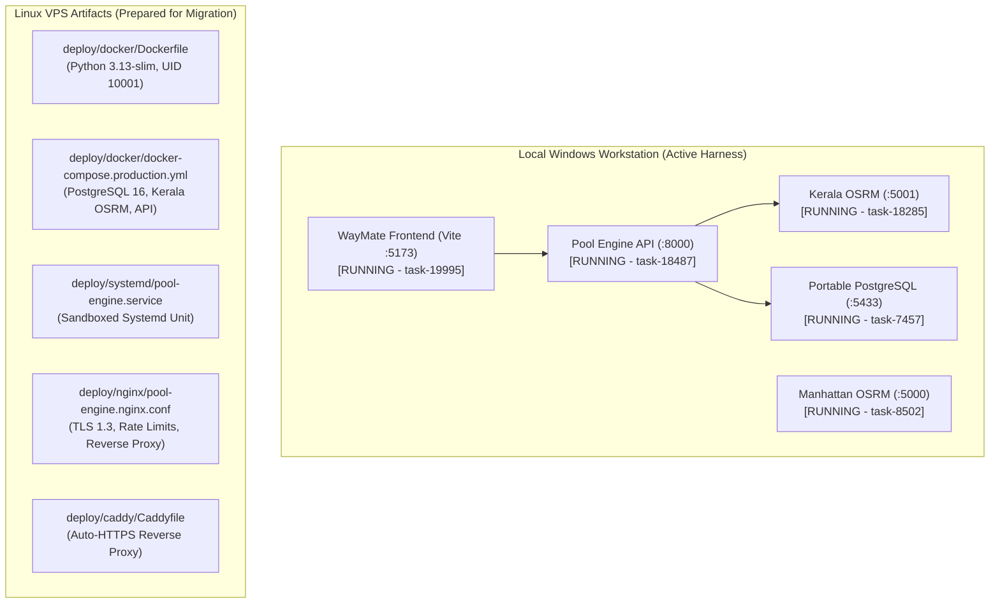

# Stage A — Repository and Infrastructure Audit

**Audit Date**: October 30, 2026  
**Environment**: Local Windows Developer Workstation & Staging Harness  
**Target Repositories**:
- `waymate` (Frontend UI, BaaS Client, Auth & Firestore Integration)
- `pool engine` (FastAPI / ASGI Dispatch Engine, Kerala OSRM Adapter, PostgreSQL Persistence)

---

## 1. Non-Negotiable Environment Separation

| Role | Firebase Project ID | Project Number | Data Sensitivity | Operational Restrictions |
|---|---|---|---|---|
| **Live Production** | `waymate-u` | `295813808280` | Real campus users, active rides, auth | **STRICTLY PROTECTED**. Zero test writes, zero rule changes, zero destructive migrations. |
| **Testing / Staging** | `waymate-v2` | `000000000000` (Local/Mock) | Test accounts, synthetic rides, mocks | **ISOLATED TEST HARNESS**. Emulators and failure injection only. |

### Enforced Guards:
1. **Compilation Guard**: [`src/config/firebase.ts`](file:///c:/Users/shaha/git%20web/waymate/src/config/firebase.ts#L68-L76) throws an explicit build exception if a production build evaluates to any project other than `waymate-u`.
2. **Multi-Target Aliasing**: [`.firebaserc`](file:///c:/Users/shaha/git%20web/waymate/.firebaserc) defines `default: "waymate-u"`, `production: "waymate-u"`, and `testing: "waymate-v2"`.
3. **Deployment Hold**: `package.json` deploy script requires explicit project flag specification (`firebase deploy -P production --only hosting`). Automatic deployment scripts are disabled.

---

## 2. Infrastructure Inventory & Local Status

### Component Status Audit:

| Component | Local Status | Implementation Details | Verified Capabilities |
|---|---|---|---|
| **Pool Engine API** | **ACTIVE** (Port 8000) | `scripts/run_staging_server.py` | ASGI 3 standard-library runtime, pure Python (no FastAPI framework lock-in), `/v1/health` and `/v1/health/readiness` operational. |
| **Kerala OSRM** | **ACTIVE** (Port 5001) | `osrm-routed-kerala.exe` | Precompiled Contraction Hierarchies graph `kerala.osrm` (13MB RAM). Sub-2ms routing across Thiruvananthapuram pilot. |
| **Manhattan OSRM** | **ACTIVE** (Port 5000) | `osrm-routed.exe` | Precompiled Contraction Hierarchies graph `manhattan.osrm` (8MB RAM). Multi-region routing validation. |
| **PostgreSQL Persistence** | **ACTIVE** (Port 5433) | `pg_portable` (`postgres.exe`) | Version 16. Databases: `pool_engine_test`, `pool_test`. 8 schema tables initialized via [`schema.sql`](file:///c:/Users/shaha/pool%20engine/src/engine/adapters/schema.sql). |
| **WayMate Frontend** | **ACTIVE** (Port 5173) | Node.js 24 + Vite | Connects to `http://127.0.0.1:8000` via proxy and direct fetch. Integrated with Write-Ahead Outbox. |
| **Docker Daemon** | **NOT INSTALLED** | Windows Host CLI | `docker` CLI not in PATH. Local validation is executed using active native background daemons. Docker specs exist for VPS deployment. |
| **Reverse Proxy (Nginx/Caddy)** | **TEMPLATES PREPARED** | `deploy/nginx/`, `deploy/caddy/` | Reverse proxy templates created with TLS 1.3, 30 req/s rate limits, and 1MB body limit. Awaiting VPS provisioning. |

---

## 3. What Works Locally vs What Requires External Infrastructure

### 1. What Already Works Locally:
- Real Kerala road-network routing and coordinate snapping (`in-kl-tvm`).
- Full multi-region request routing with failure isolation.
- Persistent PostgreSQL storage of rides, vehicles, route stops, seat holds, and idempotency records.
- Authoritative pre-dispatch capacity reconciliation.
- Monotonic version protection returning HTTP 409 Conflict (`STALE_VERSION`).
- Pending capacity buffering during process restarts.
- Write-Ahead Outbox persistence and recovery on browser restart.
- Comprehensive automated test suites (396 tests passing).

### 2. What Is Incomplete Locally:
- Docker Desktop is not installed on this local Windows machine (`docker : The term 'docker' is not recognized`). All local testing relies on native Windows daemons.
- Reverse proxy (Nginx or Caddy) is not running on the local Windows machine; requests are routed directly to `127.0.0.1:8000` or through the Vite development proxy.

### 3. What Requires External Infrastructure:
- Public domain DNS A-record (e.g. `api-pool.waymate.in` pointing to the VPS public IP).
- Let's Encrypt / ZeroSSL TLS certificate issuance.
- Linux VPS host (Ubuntu 24.04 LTS) running Docker Compose or systemd.

### 4. Adjustments Made Before Local Validation:
- Corrected `FIREBASE_PROJECT_ID` in [`deploy/docker/docker-compose.production.yml`](file:///c:/Users/shaha/pool%20engine/deploy/docker/docker-compose.production.yml) and [`.env.production.example`](file:///c:/Users/shaha/pool%20engine/.env.production.example) from `waymate-v3` to `waymate-u`.
- Updated `CORS_ALLOWED_ORIGINS` to include production domains `https://waymate-u.web.app` and `https://waymate-u.firebaseapp.com`.
- Created reverse proxy configurations for both Nginx and Caddy.
