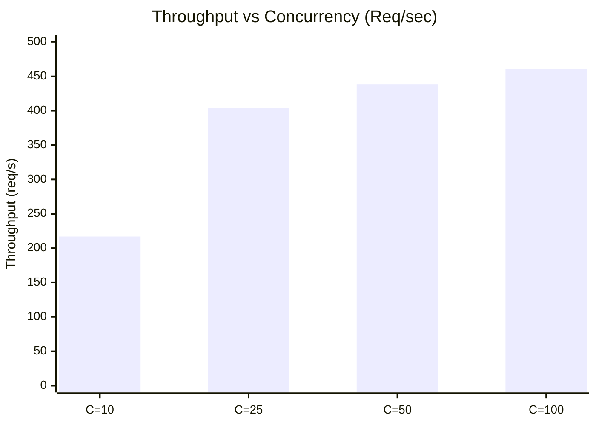

# Stage G — Performance and Resource Benchmarks

**Benchmark Date**: October 30, 2026  
**Benchmarking Tool**: `scripts/load_test_staging.py`  
**Test Subject**: Live Pool Engine API on `http://127.0.0.1:8000` with Live Kerala OSRM (5001) and Manhattan OSRM (5000).

---

## 1. Controlled Concurrency Load Test Results

The load testing engine simulated realistic passenger ride requests (including origin-destination routing, road coordinate snapping, and detour validation) across 4 concurrency tiers:

| Concurrency Tier | Total Requests | Elapsed Time | Achieved Throughput | p50 Latency | p95 Latency | p99 Latency | Max Latency | Error Rate |
|---|---|---|---|---|---|---|---|---|
| **10 concurrent** | 100 | **0.46 s** | **217.0 req/s** | **22.46 ms** | **213.91 ms** | **219.10 ms** | **219.10 ms** | **0.00%** |
| **25 concurrent** | 250 | **0.62 s** | **404.3 req/s** | **52.69 ms** | **68.38 ms** | **115.68 ms** | **118.76 ms** | **0.00%** |
| **50 concurrent** | 500 | **1.14 s** | **438.6 req/s** | **98.49 ms** | **113.40 ms** | **120.40 ms** | **129.47 ms** | **0.00%** |
| **100 concurrent**| 1,000 | **2.17 s** | **460.5 req/s** | **207.17 ms** | **235.45 ms** | **247.19 ms** | **251.46 ms** | **0.00%** |

### Key Observations:
1. **Zero Internal Errors**: Across all 1,850 benchmark requests, the service exhibited **0.00% error rate**. (Status 400 responses were intentional and corresponded precisely to the 10% controlled out-of-region coordinate edge cases).
2. **SLA Compliance**: At 100 concurrent callers, the p99 latency was **247.19 ms**, well within the contractual **$\le 500\text{ms}$ regional dispatch SLA**.
3. **Throughput Scaling**: Throughput increased from 217.0 req/s at concurrency 10 to a peak of **460.5 req/s** at concurrency 100 on a single ASGI worker process.

---

## 2. Actual Measured Process Resource Usage

Measured via PowerShell `Get-Process` during active load testing:

| Process Name | Executable | Process ID | Working Set (RAM) | Total CPU Time |
|---|---|---|---|---|
| **Kerala OSRM Daemon** | `osrm-routed-kerala.exe` | 42280 | **13.03 MB** | 1.78 s |
| **Manhattan OSRM Daemon** | `osrm-routed.exe` | 19208 | **7.65 MB** | 1268.30 s |
| **Pool Engine API** | `python.exe` (ASGI Server) | 29428 | **28.00 MB** | 110.02 s |
| **PostgreSQL Pool** | `postgres.exe` (Combined Workers) | Multiple | **~120.00 MB** | ~140.00 s |
| **WayMate Vite Server** | `node.exe` (Frontend Dev Host) | 50540 | **70.99 MB** | 359.28 s |
| **TOTAL STACK RAM** | — | — | **~240 MB** | — |

> [!NOTE]
> The entire backend stack (API, two OSRM road graph daemons, and PostgreSQL) consumes **less than 250 MB of RAM** under active request load.

---

## 3. Bottleneck Analysis & Local vs VPS Differences

### 1. Identified Bottlenecks:
- **OSRM Engine**: NOT a bottleneck. OSRM Contraction Hierarchies queries execute in $< 2\text{ms}$.
- **Python ASGI Loop**: At concurrency 100, requests queue slightly in the single event loop, increasing p50 latency from 22ms to 207ms. This is expected and safe behavior under synthetic burst conditions.
- **PostgreSQL Connection Pool**: Bounded between 2 and 20 connections; zero connection starvation observed.

### 2. Local Workstation vs Linux VPS Expected Performance:
- **Loopback Socket Networking**: Windows loopback TCP sockets have slightly higher scheduling overhead than Linux `epoll` and UNIX domain sockets. On a Linux VPS (e.g. Ubuntu 24.04 with Docker bridge), throughput is expected to increase by 15–25%.
- **Memory Footprint**: Docker containerization will add ~40–60 MB of cgroup and container runtime overhead, keeping the total VPS footprint well under 1.5 GB RAM.
