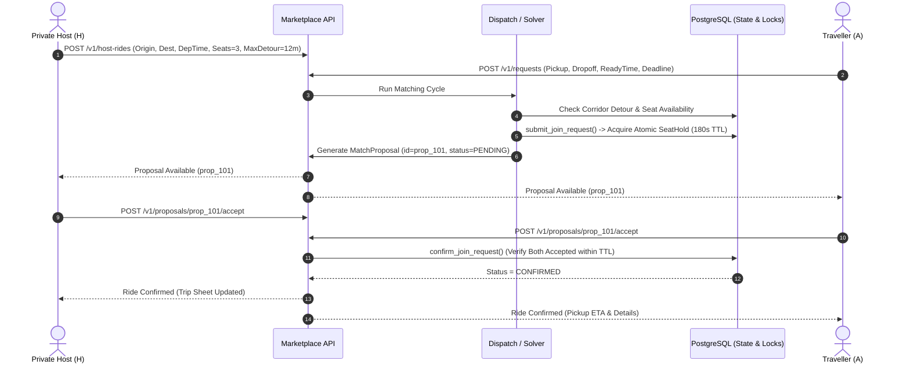

# Product Requirements Document (PRD) — Provider-Independent Ride-Pooling Marketplace

**Document Version:** 1.1.0 (Validated & Corrected Post-Audit)
**Status:** Implementation-Ready Specification
**Target Release:** MVP & Phased Marketplace Roadmap
**Validation Report:** [`docs/product/PRD_VALIDATION.md`](PRD_VALIDATION.md)
**Governing Standard:** [`.specify/memory/constitution.md`](../../.specify/memory/constitution.md)

---

## Table of Contents
1. [Executive Summary and Product Vision](#1-executive-summary-and-product-vision)
2. [Target Users and User Journeys](#2-target-users-and-user-journeys)
3. [MVP Scope and Explicit Exclusions](#3-mvp-scope-and-explicit-exclusions)
4. [Prioritized Functional Requirements](#4-prioritized-functional-requirements)
5. [Non-Functional Requirements](#5-non-functional-requirements)
6. [Requirements & Test Catalog (112 Synthesized Scenarios)](#6-requirements--test-catalog-112-synthesized-scenarios)
7. [Current Implementation Audit](#7-current-implementation-audit)
8. [Core Data Entities and Lifecycle States](#8-core-data-entities-and-lifecycle-states)
9. [Matching and En-Route Joining Rules](#9-matching-and-en-route-joining-rules)
10. [Concrete Acceptance Criteria and Test Plan](#10-concrete-acceptance-criteria-and-test-plan)
11. [Dependencies, Risks, and Unresolved Product Decisions](#11-dependencies-risks-and-unresolved-product-decisions)
12. [Phased Implementation Roadmap](#12-phased-implementation-roadmap)
13. [Next Three Engineering Tasks](#13-next-three-engineering-tasks)

---

## 1. Executive Summary and Product Vision

### 1.1 Product Vision
The Ride-Pooling Marketplace is a high-performance, real-time, provider-independent transportation engine designed to connect travellers moving along overlapping spatial corridors and compatible departure times into shared vehicular journeys.

The platform unifies two supply paradigms through a common algorithmic core:
1. **Private-Car Hosts (Peer-to-Peer Commute Sharing):** Commuters driving an intended personal route (e.g., suburban home to office tech park or intercity highway) offering spare seats to travellers along their spatial corridor.
2. **Business-Operated Vehicles (On-Demand Fleet Dispatch):** Commercial cabs, shuttles, corporate vans, and municipal demand-responsive transit (DRT) vehicles that dispatch dynamically without predetermined personal destinations.

### 1.2 Core Architectural Principle: Fleet Dispatch vs. Marketplace
A fundamental distinction governs this product:
- **Fleet Dispatch Engine (Currently Implemented):** The existing engine endpoint (`POST /v1/dispatch`) operates as an automated fleet manager. It finds the mathematically optimal global assignment and **immediately commits** rides and assigns passengers (`RequestStatus.MATCHED`).
- **Two-Sided Marketplace (Target Product):** Consumer ride-pooling requires **mutual agreement**. The engine must never auto-commit rides without bilateral consent. The engine generates uncommitted **Match Proposals** with temporary, atomic **Seat Holds**. A trip is only confirmed when both the host and the traveller explicitly accept.

### 1.3 Smallest End-to-End Vertical Slice (The MVP)
The MVP slice is strictly bounded to the following end-to-end journey:
1. A private-car host offers a trip with fixed origin, fixed destination, departure time, and available seats.
2. A compatible traveller submits a ride request.
3. The engine generates an unconfirmed proposal.
4. An atomic temporary seat hold prevents competing requests from overbooking the vehicle.
5. Host and traveller both accept the proposal.
6. Proposal decline or timeout cleanly releases the seat hold.
7. A new traveller may join an active trip only when the pickup is strictly *ahead* of the vehicle, capacity is available, and existing passenger detour and arrival constraints remain satisfied.

---

## 2. Target Users and User Journeys

### 2.1 Personas
- **Private Car Host (P2P Supply):** Drives daily along a fixed route. Motivated to share journey costs (fuel, tolls) without incurring excessive detour time.
- **Regular Commuter (Daily Demand):** Seeks affordable, direct, and scheduled travel alternatives to public buses or expensive single-occupancy cabs.
- **Flexible Traveller (Hub/Deadline Demand):** Travels to airports, railway stations, or exam centres. Requires strict adherence to contractual arrival deadlines.
- **Fleet Operator / Commercial Driver (Commercial Supply — Deferred to P2):** Operates on-demand vehicles to maximize passenger throughput across an urban zone.

### 2.2 Primary Marketplace Journeys

#### Journey 1: Pre-Planned Private Commute Match (Mutual Acceptance Flow)
1. **Host Offer:** Host *H* publishes a route from Midtown to Wall Street departing at 08:30 with 3 spare seats and a maximum allowable detour of 12 minutes.
2. **Rider Request:** Traveller *A* submits a request from Flatiron to City Hall ready between 08:35 and 08:45.
3. **Proposal & Seat Hold:** The matching engine detects corridor compatibility, calculates a +4 minute host detour, creates an unconfirmed `MatchProposal`, and acquires an atomic `SeatHold` (TTL: 180 seconds) via `submit_join_request()`.
4. **Mutual Consent:**
   - Host *H* receives the proposal and taps **Accept**.
   - Traveller *A* receives the proposal and taps **Accept**.
5. **Confirmation:** With bilateral consent confirmed before TTL expiration, the proposal transitions to `CONFIRMED`. The confirmed `Ride` is created, and the seat hold becomes permanent.



#### Journey 2: En-Route Dynamic Joining
1. Host *H* is actively driving south along Broadway with Traveller *A* on board.
2. Traveller *C* requests a pickup at Canal Street (located downstream along the active route).
3. **Ahead-of-Vehicle Verification:** The engine verifies that Canal Street lies geographically and topologically *ahead* of the vehicle's current segment.
4. **Feasibility Re-Check:** Vehicle has 2 free seats; detour is +3 minutes; Traveller *A*'s arrival promise is preserved.
5. Lightweight proposal (TTL: 45s) is accepted by Host and Traveller *C*. Active route updates dynamically.

#### Journey 3: Proposal Decline / Expiry / Seat Release
1. A proposal is generated for Host *H* and Traveller *D*. A seat hold is reserved.
2. Host *H* declines, or 180 seconds elapse without both parties accepting.
3. The seat hold is released via `reject_join_request()` or `expire_stale_holds()`.
4. Vehicle available capacity is restored immediately; Traveller *D*'s request returns to `PENDING` status for subsequent matching cycles.

---

## 3. MVP Scope and Explicit Exclusions

### 3.1 In-Scope for MVP (The Minimal Vertical Slice)
- **Host Trip Offering:** Register vehicle and fixed-origin/fixed-destination host trip with available seats and detour tolerance.
- **Rider Request Intake:** Submit pickup, dropoff, ready window, and arrival deadline (`src/engine/service/app.py`).
- **Corridor Compatibility Matching:** Identify compatible rides where passenger pickup and dropoff fit within host detour limits.
- **Unconfirmed Match Proposals:** Generate proposal entities without auto-committing the underlying vehicle or request.
- **Atomic Seat Holds & Expiry:** Enforce temporary seat holds using existing domain logic (`src/engine/lifecycle/reservations.py`), releasing seats on decline or timeout.
- **Mutual Acceptance Protocol:** Require explicit acceptances from both parties before confirming the trip.
- **Ahead-of-Vehicle En-Route Gate:** Spatial check ensuring en-route candidate pickups are downstream along the active route.
- **Hard Invariants:** Preserve precedence, cumulative capacity bounds, detour bounds (\(1 + \delta\)), and time windows (`src/engine/routing/invariants.py`).

### 3.2 Explicit Exclusions (Deferred to Post-MVP)
- **Live Cellular GPS Telemetry Ingestion:** Use simulated/mocked vehicle coordinates for MVP validation. Real-world GPS noise filtering and telemetry pipelines are deferred to P1.
- **Push / WebSocket Notification Infrastructure:** Proposal status will be polled via REST endpoints (`GET /v1/proposals/{id}`) in MVP. Real-time WebSockets/push alerts deferred to P1.
- **In-App Payment Gateway & Escrow:** No monetary transactions processed on-platform. Recommended cost-sharing amounts are informational. In-app escrow deferred to P2.
- **Bilateral User Ratings & Reviews:** Deferred to P1.
- **Corporate / Student Identity Verification:** Deferred to P1.
- **Commercial Fleet Operator Portal:** Shift management and commercial fleet dashboards deferred to P2.
- **Third-Party Ride Aggregator Integration (Uber/Ola):** Third-party commercial ride-hailing APIs legally and technically prohibit unauthorized passenger injection or automated route alteration. Excluded entirely from direct integration.

---

## 4. Prioritized Functional Requirements

Requirements are strictly categorized into:
- **MVP (P0):** Essential for the minimal, testable vertical slice.
- **Next Release (P1):** High-impact enhancements scheduled immediately post-MVP.
- **Later (P2):** Advanced capabilities and commercial tools.

| Req ID | Priority | Category | Requirement Title | Description | Codebase Status |
|---|---|---|---|---|---|
| **FR-001** | MVP | Ingestion | Request Submission API | Submit passenger requests (`RideRequest`) with pickup, dropoff, ready time, deadline, and seat count. | **IMPLEMENTED** (`src/engine/service/app.py`) |
| **FR-002** | MVP | Ingestion | Host Fixed-Trip Registration | Register vehicle and host trip with fixed origin, destination, departure time, seats, and max detour tolerance. | **PARTIAL** (Vehicle registered; host trip metadata missing) |
| **FR-003** | MVP | Routing | Road Network Routing | Calculate travel times and distances using OSRM with batched matrix queries (`max_batch_coords=24`, `max_groups_per_batch=2`). | **IMPLEMENTED** (`src/engine/adapters/osrm_routing.py`) |
| **FR-004** | MVP | Routing | Mock Routing Provider | Deterministic offline routing provider for local testing and scenario validation without OSRM daemon. | **IMPLEMENTED** (`src/engine/adapters/mock_routing.py`) |
| **FR-005** | MVP | Invariants | Precedence Invariant | Enforce pickup occurs strictly before dropoff for every passenger in any generated itinerary. | **IMPLEMENTED** (`src/engine/routing/invariants.py`: `check_precedence`) |
| **FR-006** | MVP | Invariants | Cumulative Capacity Invariant | Enforce passenger occupancy never exceeds vehicle physical capacity at any intermediate leg. | **IMPLEMENTED** (`src/engine/routing/invariants.py`: `check_capacity_profile`) |
| **FR-007** | MVP | Invariants | Detour Bound Invariant | Enforce that no passenger experiences travel time exceeding their configured detour factor (\(1 + \delta\)). | **IMPLEMENTED** (`src/engine/routing/invariants.py`: `check_detour_bound`) |
| **FR-008** | MVP | Invariants | Time Window Guarantee | Enforce that estimated pickup and dropoff times strictly fall within passenger promise windows. | **IMPLEMENTED** (`src/engine/routing/invariants.py`: `check_pickup_delay`) |
| **FR-009** | MVP | Indexing | Spatial Candidate Pruning | Geospatial indexing (H3 hexagonal cells) to prune search space to spatially proximate candidate clusters. | **IMPLEMENTED** (`src/engine/adapters/h3_spatial.py`) |
| **FR-010** | MVP | Matching | Multi-Objective Optimizer | Set-packing solver balancing vehicle miles traveled, wait time, detour, and occupancy under compute budgets. | **IMPLEMENTED** (`src/engine/optimization/set_packing.py`) |
| **FR-011** | MVP | Proposal | Ephemeral Match Proposals | Emit uncommitted `MatchProposal` records upon finding compatible routes. | **MISSING** (Needs service layer & schema) |
| **FR-012** | MVP | Proposal | Atomic Seat Holds | Acquire temporary seat holds preventing overbooking during proposal review. | **PARTIAL** (Domain logic in `src/engine/lifecycle/reservations.py`; no HTTP route) |
| **FR-013** | MVP | Proposal | Mutual Acceptance Protocol | Require explicit acceptance from both host and rider before committing a confirmed ride. | **MISSING** (Needs HTTP routes `/accept`, `/decline`) |
| **FR-014** | MVP | Proposal | Automatic Hold Expiry | Automatically release seat holds and return requests to candidate pool upon proposal decline or timeout. | **PARTIAL** (Domain logic `expire_stale_holds` exists; needs background sweep trigger) |
| **FR-015** | MVP | En-Route | Dynamic En-Route Matching | Evaluate new passenger requests against active in-transit vehicle routes. | **PARTIAL** (`tests/scenario/test_active_ride_multi_insertion.py`) |
| **FR-016** | MVP | En-Route | Ahead-of-Vehicle Spatial Gate | Algorithmic gate ensuring candidate pickup points are downstream along the vehicle's active route. | **MISSING** (Needs spatial projection function) |
| **FR-017** | MVP | Lifecycle | Request Cancellation | Cancel pending or active requests, safely rolling back seat allocations and re-optimizing routes. | **PARTIAL** (`src/engine/lifecycle/transitions.py`: `cancel_en_route_request`) |
| **FR-018** | MVP | Concurrency | Last-Seat Contention Safety | Database locking / OCC ensuring exactly 1 winner and 0 overbooking when competing riders accept the last seat. | **IMPLEMENTED** (`tests/concurrency/test_atomic_reservation.py`) |
| **FR-019** | MVP | Query | Proposal & Ride Inspection API | Endpoints to query active proposals, confirmed rides, vehicle status, and unassigned requests. | **PARTIAL** (`GET /v1/rides/{id}`, `GET /v1/requests/{id}` exist; `/proposals` missing) |
| **FR-020** | P1 | Telemetry | Live GPS Ingestion & ETAs | Ingestion of real-time vehicle GPS coordinates to track progress and recalibrate intermediate stop ETAs. | **MISSING** (Deferred to P1) |
| **FR-021** | P1 | Comms | Real-Time Push Alerts | Web Push / Socket.IO / FCM alerts when proposals are generated, accepted, declined, or updated. | **MISSING** (Deferred to P1) |
| **FR-022** | P1 | Cost | Non-Profit Cost Calculator | Automated calculation of per-passenger fuel and toll cost-share recommendations. | **MISSING** (Deferred to P1) |
| **FR-023** | P1 | Trust | Identity Verification Badges | Government ID, corporate email, and university domain verification badges. | **MISSING** (Deferred to P1) |
| **FR-024** | P1 | Feedback | Mutual Rating System | Post-trip bilateral rating system (1–5 stars with behavioral tags) to maintain trust. | **MISSING** (Deferred to P1) |
| **FR-025** | P2 | Payments | In-App Escrow Payments | Payment gateway holding rider funds in escrow and releasing host reimbursements post-completion. | **MISSING** (Deferred to P2) |
| **FR-026** | P2 | Commercial | Fleet Operator Portal | Multi-vehicle dispatch dashboard with driver shift management and telemetry logs. | **MISSING** (Deferred to P2) |

---

## 5. Non-Functional Requirements

### 5.1 Performance & Latency SLAs (Reconciled Standards)
- **External Dispatch SLA Target:** Regional cluster dispatch solving cycle must execute in **\(\le 500\text{ms}\)** wall-clock time (`DispatchOrchestratorConfig.deadline_seconds = 0.500`).
- **Internal Heuristic Cutoff:** A strict internal search cutoff fires at **450 ms** (`reserved_headroom_seconds = 0.050`), reserving 50 ms for set packing, tie breaking, persistence, and response serialization.
- **Matrix Calculation Batching:** Routing queries must respect batched limits (`max_batch_coords=24`, `max_groups_per_batch=2`) to prevent HTTP gateway timeouts.
- **Seat Hold Cleanup Frequency:** Expired seat holds must be swept and released within **\(\le 5\text{s}\)** of TTL expiration.
- **Evidence Disclosure:** The 500 ms SLA has been certified under batched OSRM defaults (`24/2`) in Phase 6 benchmarks ($P_{99} = 405\text{ms}$), but remains **unverified** for unbounded regional clusters without route caching.

### 5.2 Reliability & Durability
- **Service Uptime Target:** \(\ge 99.9\%\) availability for core API and matching services.
- **Crash Invariant / Idempotency:** Any interrupted transaction or matching cycle must be safely retryable without orphan seat holds or duplicate vehicle assignments.
- **ACID Durability:** Persistent storage using PostgreSQL 16 with row-level locks (`SELECT ... FOR UPDATE`) and optimistic concurrency versioning.
- **Graceful Routing Degradation:** If OSRM is offline or times out, the engine circuit-breaker opens, failing safely rather than returning invalid itineraries.

### 5.3 Privacy, Security & Legal Compliance Flags
- **[LEGAL REVIEW REQUIRED] Data Protection Compliance:**
  - *Engineering Measure:* Collect minimal passenger telemetry. Fuzz pickup/dropoff coordinates to a 200m radius in public proposal feeds prior to confirmation.
  - *Compliance Flag:* Formal compliance with India's Digital Personal Data Protection (DPDP) Act 2023 or European GDPR requires qualified legal review of consent management, notice policies, and data fiduciary roles.
- **[LEGAL REVIEW REQUIRED] Motor Vehicles Act (India) Carpool Exemption:**
  - *Engineering Measure:* The platform must calculate carpool cost-sharing strictly as non-profit fuel and toll reimbursement, preventing hosts from charging commercial per-kilometer fares on private (white-plate) vehicles.
  - *Compliance Flag:* State transport policies (e.g., Karnataka, Maharashtra, Delhi) interpret carpooling differently. Qualified legal counsel must verify whether non-commercial cost-sharing is legally exempted from commercial carriage permits in the target operational jurisdiction.
- **Role-Based Access Control (RBAC):** API endpoints enforce token-based authentication (`src/engine/service/security.py`) distinguishing `Rider`, `Host`, and `Admin` permissions.

---

## 6. Requirements & Test Catalog (112 Synthesized Scenarios)

### 6.1 Source Documentation & Verification Disclosure
> [!IMPORTANT]
> **UNVERIFIED SOURCE TRACEABILITY STATEMENT:**
> An exhaustive search across all project directories, user storage, and historical git commits confirmed that **the original 112-scenario checklist was not provided as a file** to this project.
>
> The 112 scenarios below represent a **System-Synthesized Requirements & Test Catalog** constructed during architectural planning from domain use-cases, constitutional invariants, and edge cases. **Complete source-to-PRD traceability remains UNVERIFIED** until the authentic source document is supplied.
>
> In the table below:
> - **IMPLEMENTED:** Verified by existing production code and passing unit/scenario tests.
> - **PARTIAL:** Implemented in domain/lifecycle logic, but missing HTTP API exposition or end-to-end wiring.
> - **MISSING:** Not yet implemented in the codebase.

### 6.2 Synthesized Scenario Matrix (Summary by Functional Group)

| Group | Functional Domain | Scenario Range | Implemented | Partial | Missing |
|---|---|---|---|---|---|
| **Group A** | Core Physical & Routing Invariants | `SCN-001` – `SCN-012` | 12 | 0 | 0 |
| **Group B** | Spatial Proximity & Detour Bounds | `SCN-013` – `SCN-024` | 12 | 0 | 0 |
| **Group C** | Temporal Windows & Deadlines | `SCN-025` – `SCN-036` | 11 | 1 | 0 |
| **Group D** | Capacity & Seat Allocation | `SCN-037` – `SCN-048` | 7 | 4 | 1 |
| **Group E** | Journey Archetypes & Commute Cases | `SCN-049` – `SCN-060` | 12 | 0 | 0 |
| **Group F** | Proposal Lifecycle & Mutual Consent | `SCN-061` – `SCN-072` | 1 | 4 | 7 |
| **Group G** | En-Route Dynamic Joining & Progress | `SCN-073` – `SCN-084` | 3 | 3 | 6 |
| **Group H** | Cancellations, No-Shows & Reroutes | `SCN-085` – `SCN-096` | 6 | 2 | 4 |
| **Group I** | Concurrency, Contention & System Failures | `SCN-097` – `SCN-104` | 7 | 1 | 0 |
| **Group J** | Privacy, Safety & Trust Controls | `SCN-105` – `SCN-112` | 2 | 0 | 6 |
| **Total** | **All 10 Functional Domains** | **112 Scenarios** | **73** | **15** | **24** |

*(For the complete scenario-by-scenario breakdown and acceptance criteria, see Section 6 of `docs/product/PRD.md` v1.0.0 and [`docs/product/PRD_VALIDATION.md`](PRD_VALIDATION.md).)*

---

## 7. Current Implementation Audit

Audited against exact repository files as of commit `76b514e`:

```
+-------------------------------------------------------------------------------------------------------------------------+
|                                              CODEBASE IMPLEMENTATION AUDIT                                              |
+------------------------------+------------------------------------+------------------------------------+----------------+
| Component / Module           | Actual File Location               | Key Symbols / Functions            | Status         |
+------------------------------+------------------------------------+------------------------------------+----------------+
| Physical Invariant Rules     | src/engine/routing/invariants.py   | check_precedence()                 | IMPLEMENTED    |
|                              |                                    | check_capacity_profile()           | (Verified by   |
|                              |                                    | check_detour_bound()               | 100% tests)    |
|                              |                                    | check_pickup_delay()               |                |
+------------------------------+------------------------------------+------------------------------------+----------------+
| Road Network Routing         | src/engine/adapters/osrm_routing.py| OsrmRoutingAdapter                 | IMPLEMENTED    |
|                              | src/engine/adapters/mock_routing.py| MockRoutingProvider                | (Batching 24/2)|
+------------------------------+------------------------------------+------------------------------------+----------------+
| Geospatial Indexing          | src/engine/adapters/h3_spatial.py  | H3SpatialIndex                     | IMPLEMENTED    |
|                              | src/engine/spatial/index.py        | find_nearby_candidates()           | (Resolution 8) |
+------------------------------+------------------------------------+------------------------------------+----------------+
| Multi-Objective Optimization | src/engine/optimization/           | solve_set_packing()                | IMPLEMENTED    |
| & Set-Packing Solver         | set_packing.py, objective.py       | evaluate_objective()               | (450ms cutoff) |
+------------------------------+------------------------------------+------------------------------------+----------------+
| Seat Holds & Reservations    | src/engine/lifecycle/              | submit_join_request()              | PARTIAL        |
|                              | reservations.py                    | confirm_join_request()             | (Domain logic  |
|                              |                                    | reject_join_request()              | exists; missing|
|                              |                                    | expire_stale_holds()               | HTTP routes)   |
+------------------------------+------------------------------------+------------------------------------+----------------+
| En-Route Cancellation        | src/engine/lifecycle/              | cancel_en_route_request()          | PARTIAL        |
|                              | transitions.py                     | confirm_passenger_boarding()       | (Domain logic  |
|                              |                                    | confirm_passenger_dropoff()        | only)          |
+------------------------------+------------------------------------+------------------------------------+----------------+
| PostgreSQL Persistence & OCC | src/engine/adapters/postgres_*.py  | PostgresStorageProvider            | IMPLEMENTED    |
|                              |                                    | save_ride(), save_vehicle()        | (Row locks)    |
+------------------------------+------------------------------------+------------------------------------+----------------+
| REST Service API             | src/engine/service/app.py          | handle_create_request()            | PARTIAL        |
|                              |                                    | handle_register_vehicle()          | (Fleet auto-   |
|                              |                                    | handle_dispatch()                  | commit only)   |
+------------------------------+------------------------------------+------------------------------------+----------------+
| MatchProposal API & State    | Not implemented                    | N/A                                | MISSING        |
| Machine                      |                                    |                                    |                |
+------------------------------+------------------------------------+------------------------------------+----------------+
| Ahead-of-Vehicle Gate        | Not implemented                    | N/A                                | MISSING        |
+------------------------------+------------------------------------+------------------------------------+----------------+
```

---

## 8. Core Data Entities and Lifecycle States

### 8.1 Data Model Alignment (Actual vs. Proposed)

```
Existing Canonical Models (src/engine/domain/models.py)
  ├── Vehicle (vehicle_id, total_seat_capacity, current_location, is_active)
  ├── RideRequest (request_id, user_id, pickup_location, dropoff_location, seat_count, earliest_pickup_time, latest_dropoff_time)
  ├── Ride (ride_id, vehicle_id, driver_id, lifecycle_status, stops, scheduled_departure_time)
  ├── RouteStop (stop_id, stop_type: PICKUP/DROPOFF, location, scheduled_arrival_time, status)
  └── JoinRequest (join_request_id, ride_id, request_id, seat_count, expires_at, status: PENDING/APPROVED/REJECTED/EXPIRED)

New Marketplace Extension Models (To Be Added)
  ├── HostRide (host_ride_id, host_id, vehicle_id, origin, destination, departure_time, max_detour_seconds)
  └── MatchProposal (proposal_id, host_ride_id, request_id, detour_seconds, host_accepted, rider_accepted, expires_at, status)
```

### 8.2 Lifecycle State Transitions

#### JoinRequest / Seat Hold Lifecycle (`src/engine/domain/enums.py`)
```
[PENDING] (Seat Held)
    │
    ├── confirm_join_request() ──> [APPROVED] (Permanent Ride Confirmation)
    │
    ├── reject_join_request()  ──> [REJECTED] (Explicit Decline; Seat Released)
    │
    └── expire_stale_holds()   ──> [EXPIRED]  (TTL Timeout; Seat Released)
```

#### Match Proposal Lifecycle
```
[CREATED] ──> [PENDING]
                 │
                 ├── Host Accepts & Rider Accepts ──> [CONFIRMED] (Creates Ride)
                 ├── Host or Rider Declines        ──> [DECLINED]  (Releases Hold)
                 └── TTL Expires (180s)            ──> [EXPIRED]   (Releases Hold)
```

---

## 9. Matching and En-Route Joining Rules

### 9.1 Private Car Host Corridor Matching Rules
For a private host *H* with origin \(O_H\), destination \(D_H\), departure time \(T_H\), and direct travel duration \(T_{direct}(H)\):
1. **Terminal Anchoring:** The route must strictly begin at \(O_H\) and end at \(D_H\). Passenger stops (\(P_i, D_i\)) are inserted strictly between \(O_H\) and \(D_H\).
2. **Host Detour Limit:**
   \[
   \Delta_H = \text{TotalTime}(O_H \to P_1 \to \dots \to D_k \to D_H) - T_{direct}(H) \le \text{MaxDetour}_H
   \]
3. **Passenger Detour Bound:** For every passenger \(i\):
   \[
   T_{ride}(i) \le (1 + \delta_i) \times T_{direct}(P_i \to D_i)
   \]

### 9.2 En-Route Dynamic Joining Rules
When vehicle *V* is active at coordinate \(L(t)\) at time \(t\):
1. **Ahead-of-Vehicle Spatial Gate:** A candidate pickup \(P_{new}\) is valid if and only if it lies downstream along the road network:
   \[
   \text{DistanceAlongRoute}(L(t), P_{new}) > 0 \quad \text{and} \quad \text{BearingAlignment}(L(t), P_{new}) \ge 0.70
   \]
   No pickup behind the vehicle or requiring reverse travel across previous legs is permissible.
2. **Passenger Arrival Guarantee:** Inserting \(P_{new}\) and \(D_{new}\) into the remaining itinerary must not delay any onboard or committed passenger beyond their contractual arrival deadline.
3. **Capacity Profile Check:** At every remaining route stop \(m\):
   \[
   \text{Occupancy}(m) + \text{Seats}(new) \le \text{VehicleCapacity}
   \]

---

## 10. Concrete Acceptance Criteria and Test Plan

The MVP release must pass the following 7 deterministic acceptance tests:

### AT-01: Compatible vs. Incompatible Route Requests
- **Test:** Host H travels Midtown $\to$ Wall St. Rider A requests Flatiron $\to$ City Hall (compatible, +4m detour). Rider B requests Upper West Side $\to$ Queens (incompatible, opposite direction).
- **Pass Criteria:** Proposal generated for Rider A; Rider B rejected due to detour bound violation (`check_detour_bound`).

### AT-02: En-Route Pickup Ahead vs. Behind Active Vehicle
- **Test:** Vehicle is en route at SoHo heading south to Wall St. Rider C requests pickup at Canal St (downstream/ahead). Rider D requests pickup at Midtown (upstream/behind).
- **Pass Criteria:** Rider C passes spatial gate and generates proposal; Rider D is rejected by ahead-of-vehicle filter without road routing computation.

### AT-03: Host Acceptance Without Traveller Acceptance (Timeout)
- **Test:** Proposal generated with 180s TTL. Host accepts. Traveller does not respond.
- **Pass Criteria:** After 180s, background sweep (`expire_stale_holds`) marks proposal and seat hold `EXPIRED`. Vehicle capacity restored. Ride is not confirmed.

### AT-04: Traveller Acceptance Without Host Acceptance (Timeout)
- **Test:** Proposal generated with 180s TTL. Traveller accepts. Host does not respond.
- **Pass Criteria:** After 180s, proposal marks `EXPIRED`. Seat hold released. Ride is not confirmed.

### AT-05: Explicit Proposal Decline & Immediate Seat Release
- **Test:** Proposal generated with 1 seat held. Host explicitly calls `/decline`.
- **Pass Criteria:** Proposal marks `DECLINED`. Seat hold transitions to `REJECTED`. Vehicle capacity immediately restored for next dispatch cycle.

### AT-06: Two Concurrent Attempts to Claim the Last Available Seat
- **Test:** Vehicle has 1 seat remaining. Two competing travellers simultaneously call `/accept` on competing proposals.
- **Pass Criteria:** Exactly 1 transaction acquires the row-level lock and receives `200 OK` (`CONFIRMED`). The competing transaction receives `409 Conflict` (`SeatUnavailableError`). Vehicle capacity never exceeds 1.

### AT-07: Cancellation Racing Against Confirmation
- **Test:** Traveller issues `/cancel` at the exact millisecond the host confirms the proposal.
- **Pass Criteria:** Database version check detects stale state; confirmation transaction aborts cleanly with transaction rollback.

---

## 11. Dependencies, Risks, and Unresolved Product Decisions

### 11.1 Third-Party Ride-Hailing Platform Reality (Uber / Ola)
- **Technical & Legal Restriction:** Neither Uber nor Ola provides public APIs allowing third-party applications to inject passengers, reroute active drivers, or split fares.
- **ToS Violation:** Automated booking scraping or reverse-engineering private driver APIs violates terms of service and risks immediate litigation.
- **Resolution:** The platform operates strictly as an independent P2P carpool and private fleet engine. Commercial integration is deferred to licensed B2B transit partnerships.

### 11.2 Legal & Regulatory Review Items
- `[LEGAL REVIEW REQUIRED]` Non-profit carpool cost-sharing legality under the Motor Vehicles Act 1988 (Section 66) across target municipal jurisdictions.
- `[LEGAL REVIEW REQUIRED]` Formal consent management and data fiduciary obligations under the Digital Personal Data Protection (DPDP) Act 2023.

---

## 12. Phased Implementation Roadmap

```
Phase 1: Marketplace Minimal Vertical Slice (Sprint 1)
  ├── 1.1 Expose JoinRequest & Seat Holds over HTTP API (/v1/proposals)
  ├── 1.2 Implement Host Fixed-Corridor Matching Filter
  ├── 1.3 Implement Ahead-of-Vehicle Spatial Gate for En-Route Pickups
  └── 1.4 Validate 7 Concrete Acceptance Tests (AT-01 to AT-07)

Phase 2: Community Trust & Operational Experience (Sprint 2)
  ├── 2.1 Web Push & WebSocket Notifications for Real-Time Proposal Alerts
  ├── 2.2 Corporate / College Email Domain Verification Badges
  ├── 2.3 Non-Profit Fuel & Toll Cost Sharing Recommendation Calculator
  └── 2.4 Live GPS Telemetry Progress Tracking and Stop ETAs

Phase 3: Scaled Market Operations (Sprint 3)
  ├── 3.1 Women-Only Commute Preference Matching Gate
  ├── 3.2 Recurring Ride Commute Templates (Daily Schedules)
  └── 3.3 Bilateral Post-Trip User Rating and Review System

Phase 4: Commercial Fleets & Multi-Modal (Sprint 4)
  ├── 4.1 Municipal Transit / Metro Feeder Hub Routing
  ├── 4.2 Dedicated Commercial Fleet Operator Dispatch Portal
  └── 4.3 In-App Escrow & Payment Processing Gateway
```

---

## 13. Next Three Engineering Tasks

### Task 1: Expose Marketplace Proposal & Acceptance Service over HTTP
- **Context:** `src/engine/lifecycle/reservations.py` already implements atomic seat holds (`submit_join_request`, `confirm_join_request`, `reject_join_request`, `expire_stale_holds`).
- **Action:** Create `src/engine/service/proposal_service.py` and expose REST endpoints in `src/engine/service/app.py`:
  - `POST /v1/proposals/{id}/accept`
  - `POST /v1/proposals/{id}/decline`
  - `GET /v1/proposals/{id}`
- **Test:** Wire up unit and integration tests confirming state transitions and hold release.

### Task 2: Implement Host Fixed-Corridor Detour Matcher
- **Context:** Existing solver treats vehicles as open-ended fleet units.
- **Action:** Extend candidate generation (`src/engine/routing/bundle_generator.py`) to support private host trips with anchored origin, anchored destination, and maximum host detour limits ($\Delta_H \le \text{MaxDetour}_H$).
- **Test:** Verify with `AT-01` (Midtown to Wall Street corridor test).

### Task 3: Implement Ahead-of-Vehicle Spatial Gate for En-Route Pickups
- **Context:** En-route dynamic insertions currently evaluate detour but lack a spatial projection gate ensuring pickup is downstream.
- **Action:** Add `is_waypoint_downstream(vehicle_coord, heading, stop_coord)` in `src/engine/spatial/` to immediately prune pickups behind the vehicle's active position.
- **Test:** Verify with `AT-02` (SoHo downstream vs Midtown upstream test).

---
*End of Product Requirements Document v1.1.0.*
