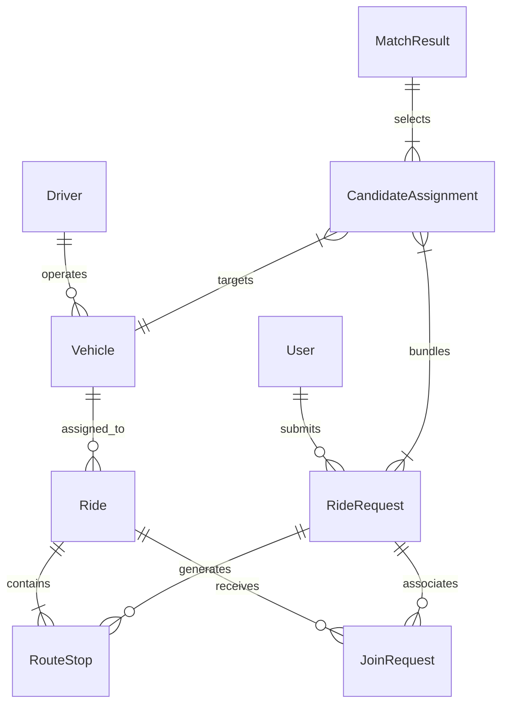
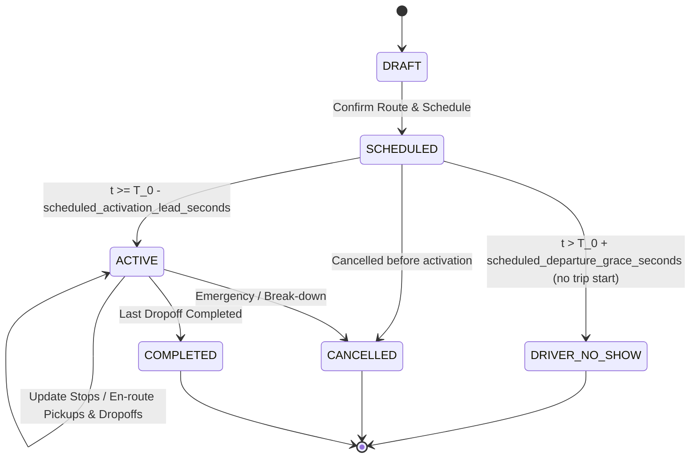
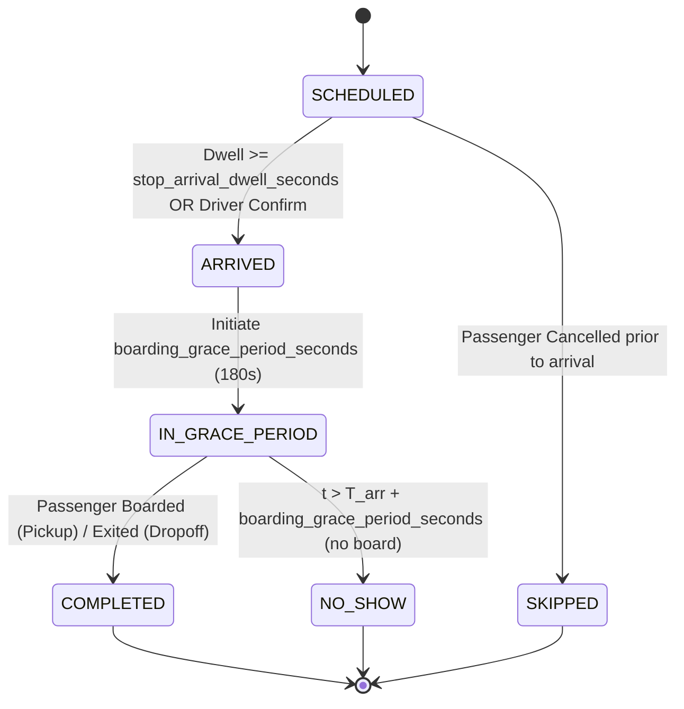
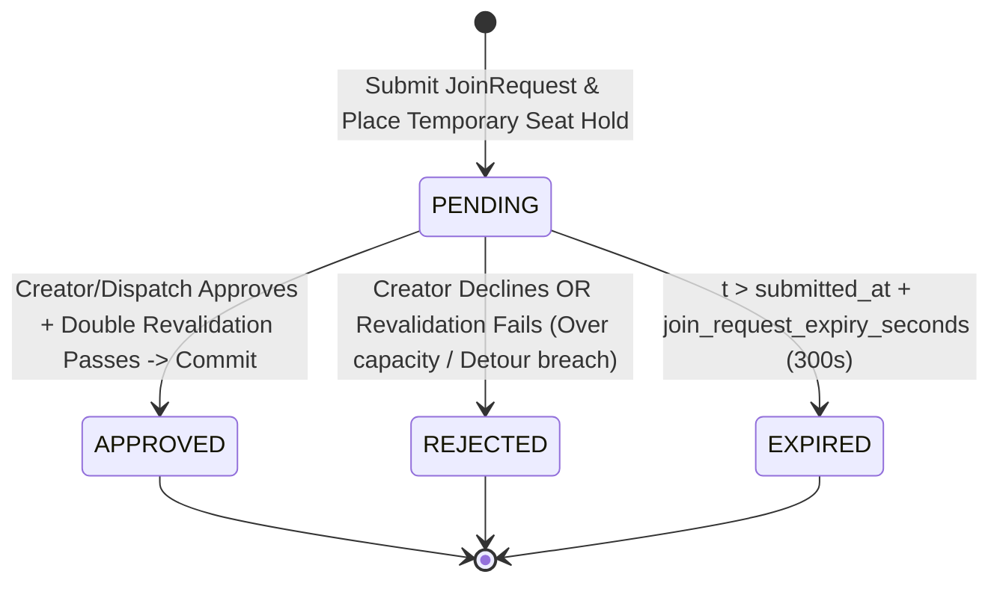

# Canonical Domain Model & State Specification

**Feature**: `001-ride-pooling-core`  
**Phase**: Phase 1 (Data Design & Contracts)  
**Date**: 2026-10-24  
**Status**: Revised & Mathematically Validated  

---

## 1. Domain Entities & Schemas

All domain models are implemented as immutable, strictly validated schemas using standard Python dataclasses or Pydantic V2 models. All geographic coordinates use WGS84 standard floating-point representation (`latitude`, `longitude`). All temporal fields use Unix timestamps in **integer seconds**.

### 1.1 GeoCoordinate
Represents a geographical location on the WGS84 ellipsoid.
- `latitude`: `float` (range: $[-90.0, 90.0]$)
- `longitude`: `float` (range: $[-180.0, 180.0]$)

### 1.2 User (Passenger)
Represents a passenger or group organizer requesting transportation.
- `user_id`: `str` (UUIDv4)
- `name`: `str`
- `accessibility_requirements`: `list[str]` (e.g., wheelchair access, service animal)
- `created_at`: `int` (timestamp in seconds)

### 1.3 Driver
Represents a registered vehicle operator executing routes.
- `driver_id`: `str` (UUIDv4)
- `name`: `str`
- `active_status`: `DriverStatus` (`OFFLINE`, `AVAILABLE`, `ASSIGNED`, `ON_TRIP`, `ON_BREAK`)
- `current_location`: `GeoCoordinate`
- `shift_start_time`: `int` (timestamp)
- `shift_end_time`: `int` (timestamp)
- `total_idle_seconds`: `int` (accumulated idle time during active shift)

### 1.4 Vehicle
Represents a physical motor vehicle executing pooled rides.
- `vehicle_id`: `str` (UUIDv4)
- `driver_id`: `str` (foreign key to `Driver`)
- `total_seat_capacity`: `int` (range: $[1, 50]$, typical: $4 - 7$)
- `luggage_capacity_units`: `int` (integer volume units)
- `current_location`: `GeoCoordinate`
- `is_active`: `bool`

### 1.5 RouteStop
Represents a scheduled stop along a vehicle's route itinerary.
- `stop_id`: `str` (UUIDv4)
- `ride_id`: `str` (foreign key to `Ride`)
- `request_id`: `str` (foreign key to `RideRequest`)
- `stop_type`: `StopType` (`PICKUP`, `DROPOFF`, `WAYPOINT`)
- `location`: `GeoCoordinate`
- `passenger_delta`: `int` ($+N$ for pickup, $-N$ for dropoff)
- `scheduled_arrival_time`: `int` (estimated arrival timestamp)
- `promised_window_start`: `int` (earliest promised time)
- `promised_window_end`: `int` (latest promised time)
- `actual_arrival_time`: `int | None` (timestamp when dwell threshold reached)
- `dwell_duration_seconds`: `int` (accumulated dwell time at stop)
- `status`: `StopStatus` (`SCHEDULED`, `ARRIVED`, `COMPLETED`, `NO_SHOW`, `SKIPPED`)

### 1.6 Ride
Represents a vehicle trip instance managing an ordered itinerary of stops.
- `ride_id`: `str` (UUIDv4)
- `vehicle_id`: `str` (foreign key to `Vehicle`)
- `driver_id`: `str` (foreign key to `Driver`)
- `lifecycle_status`: `RideStatus` (`DRAFT`, `SCHEDULED`, `ACTIVE`, `COMPLETED`, `CANCELLED`, `DRIVER_NO_SHOW`)
- `stops`: `tuple[RouteStop, ...]` (strictly ordered by itinerary sequence)
- `scheduled_departure_time`: `int` (timestamp of first scheduled departure)
- `actual_departure_time`: `int | None`
- `active_passenger_count`: `int` (instantaneous passenger count)
- `total_vmt_meters`: `int` (accumulated vehicle meters traveled)
- `version`: `int` (optimistic concurrency version counter, incremented upon every commit)

### 1.7 RideRequest
Represents a demand entry submitted by a user.
- `request_id`: `str` (UUIDv4)
- `user_id`: `str` (foreign key to `User`)
- `pickup_location`: `GeoCoordinate`
- `dropoff_location`: `GeoCoordinate`
- `seat_count`: `int` (range: $[1, \text{VehicleCapacity}]$)
- `earliest_pickup_time`: `int` (timestamp)
- `latest_dropoff_time`: `int` (timestamp)
- `direct_distance_meters`: `int` (direct road distance between pickup and dropoff)
- `direct_duration_seconds`: `int` ($T_{\text{direct}}$, direct travel time)
- `status`: `RequestStatus` (`PENDING`, `MATCHED`, `IN_TRANSIT`, `COMPLETED`, `EXPIRED`, `CANCELLED`)
- `matched_ride_id`: `str | None`

### 1.8 JoinRequest
Represents a prospective passenger's request to join an active or scheduled ride.
- `join_request_id`: `str` (UUIDv4)
- `ride_id`: `str` (foreign key to `Ride`)
- `request_id`: `str` (foreign key to `RideRequest`)
- `user_id`: `str` (foreign key to `User`)
- `seat_count`: `int` (number of seats requested)
- `submitted_at`: `int` (epoch seconds timestamp)
- `expires_at`: `int` (epoch seconds timestamp = `submitted_at + join_request_expiry_seconds`)
- `status`: `JoinStatus` (`PENDING`, `APPROVED`, `REJECTED`, `EXPIRED`)
- `idempotency_token`: `str` (client-provided transaction key preventing duplicate seat allocations)

*Seat Hold Synchronization*: The temporary seat hold is directly owned by this `JoinRequest`, sharing the identical expiration timestamp `expires_at`. The hold remains valid while current time $t \le \text{expires\_at}$; at $t > \text{expires\_at}$ or upon creator rejection, the hold is automatically released back to available vehicle capacity.

### 1.9 CandidateAssignment (Fleet Assignment Hyperedge)
Represents a candidate assignment bundle of one or more requests mapped to a vehicle or existing ride.
- `candidate_id`: `str` (UUIDv4)
- `vehicle_id`: `str`
- `existing_ride_id`: `str | None` (set if candidate inserts into an existing ride)
- `request_ids`: `tuple[str, ...]` (bundle of matched requests $\{r_1, r_2, \dots, r_k\}$)
- `ordered_stops`: `tuple[RouteStop, ...]` (complete re-ordered stop sequence)
- `peak_seat_load`: `int` (maximum concurrent occupancy across all legs $\le Capacity$)
- `vmt_meters`: `int` (total planned route road distance)
- `objective_value`: `float` (raw composite utility $J \in [-0.60, +0.40]$)
- `normalized_score`: `float` ($J_{\text{display}} \in [0.0, 1.0]$)
- `score_breakdown`: `ScoreBreakdown` (itemized $S_{\text{vmt}}$, $P_{\text{detour}}$, $P_{\text{wait}}$, $P_{\text{idle}}$)

### 1.10 MatchResult
Represents the deterministic output of a batch optimization solve cycle.
- `match_id`: `str` (UUIDv4)
- `batch_id`: `str` (UUIDv4)
- `solver_timestamp`: `int` (timestamp)
- `selected_assignments`: `tuple[CandidateAssignment, ...]` (mutually disjoint winning bundles)
- `unassigned_request_ids`: `tuple[str, ...]`
- `total_vmt_savings_meters`: `int`
- `solve_duration_ms`: `float`

---

## 2. Entity Relationship Diagram

---

## 3. State Machines & Lifecycle Transitions

### 3.1 Ride Lifecycle State Machine

### 3.2 Route Stop Lifecycle State Machine

### 3.3 Join Request Lifecycle State Machine

