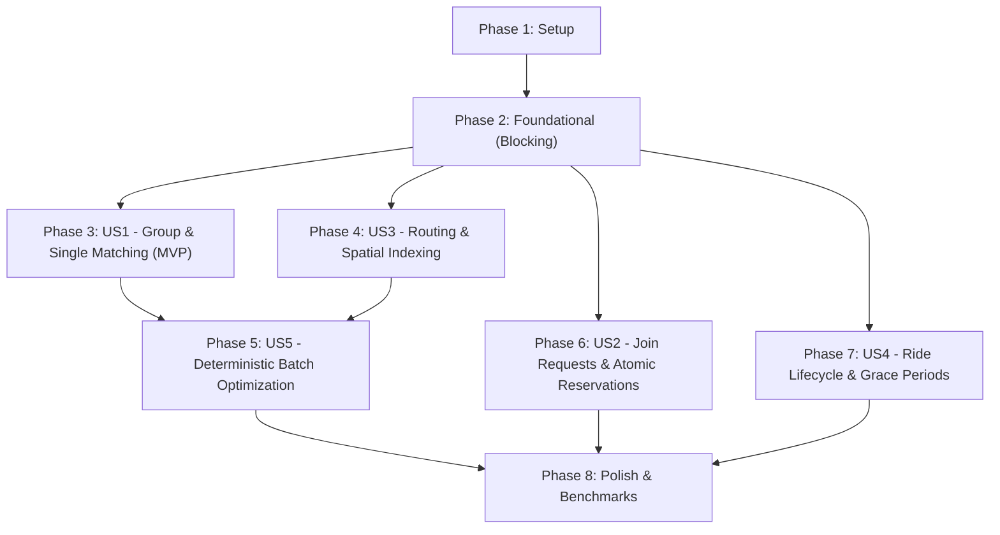

# Tasks: Core Provider-Independent Ride-Pooling and Dispatch Engine

**Input**: Design documents from `specs/001-ride-pooling-core/` (`spec.md`, `plan.md`, `research.md`, `data-model.md`, `contracts/`, `quickstart.md`, `checklists/requirements.md`)  
**Prerequisites**: `spec.md` (ratified requirements), `plan.md` (architecture & algorithms), `data-model.md` (schemas & state machines), `contracts/` (provider ABCs), `.specify/memory/constitution.md` (governance & physical invariants)  
**TDD Discipline**: Test-First Development is strictly enforced. Tests MUST be written and confirmed failing before implementation code is written.  
**Provider Independence**: The core engine must never import or couple to commercial rideshare or mapping SDKs.

---

## Format: `- [ ] [TaskID] [P?] [Story?] Description with file path`

- **[P]**: Can run in parallel (different files, no blocking dependencies on incomplete tasks)
- **[Story]**: Associated user story (`[US1]`, `[US2]`, `[US3]`, `[US4]`, `[US5]`)
- Every task includes an explicit target file path and concrete completion criteria.

---

## Phase 1: Setup (Shared Infrastructure)

**Purpose**: Project initialization, directory structure, dependency management, and strict static analysis configuration.

- [X] T001 Create project package and test directory layout per implementation plan (`src/engine/domain/`, `src/engine/contracts/`, `src/engine/spatial/`, `src/engine/routing/`, `src/engine/optimization/`, `src/engine/lifecycle/`, `src/engine/adapters/`, `tests/unit/`, `tests/scenario/`, `tests/concurrency/`, `tests/property/`, `tests/benchmark/`)
- [X] T002 Initialize Python 3.13 configuration in `pyproject.toml` with runtime dependencies (`pydantic>=2.0`, `numpy`, `h3>=3.7.0`) and test dependencies (`pytest>=8.0`, `hypothesis>=6.0`, `pytest-benchmark>=4.0`, `mypy>=1.10`)
- [X] T003 Configure strict typing and linting profiles in `pyproject.toml` enforcing `mypy --strict`, zero implicit `Any`, PEP 8 standards, and PowerShell 5.1 compatibility (depends on T002)

---

## Phase 2: Foundational (Blocking Prerequisites)

**Purpose**: Canonical domain models, lifecycle enums, provider interface contracts, and default mock adapters.  
**CRITICAL**: All user story phases depend on this foundation. No user story implementation can begin until Phase 2 is complete.

- [X] T004 [P] Write unit tests for canonical enums and domain schema validation in `tests/unit/test_models.py` verifying field bounds, type constraints, and immutability
- [X] T005 [P] Implement canonical status enums in `src/engine/domain/enums.py`:
  - `RideStatus` (`DRAFT`, `SCHEDULED`, `ACTIVE`, `COMPLETED`, `CANCELLED`, `DRIVER_NO_SHOW`)
  - `StopStatus` (`SCHEDULED`, `ARRIVED`, `IN_GRACE_PERIOD`, `COMPLETED`, `NO_SHOW`, `SKIPPED`)
  - `JoinStatus` (`PENDING`, `APPROVED`, `REJECTED`, `EXPIRED`)
  - `DriverStatus` (`OFFLINE`, `AVAILABLE`, `ASSIGNED`, `ON_TRIP`, `ON_BREAK`)
  - `StopType` (`PICKUP`, `DROPOFF`, `WAYPOINT`)
  - `RequestStatus` (`PENDING`, `MATCHED`, `IN_TRANSIT`, `COMPLETED`, `EXPIRED`, `CANCELLED`)
- [X] T006 [P] Implement immutable canonical domain entities in `src/engine/domain/models.py` with verbatim validation rules from `data-model.md`:
  - `GeoCoordinate`: `latitude` in $[-90.0, 90.0]$, `longitude` in $[-180.0, 180.0]$
  - `User`: `user_id` (UUIDv4), `accessibility_requirements` (list[str])
  - `Driver`: `driver_id` (UUIDv4), `current_location` (`GeoCoordinate`), `total_idle_seconds` ($\ge 0$)
  - `Vehicle`: `vehicle_id` (UUIDv4), `total_seat_capacity` in $[1, 50]$, `current_location` (`GeoCoordinate`), `is_active` (`bool`)
  - `RouteStop`: `stop_id` (UUIDv4), `stop_type` (`StopType`), `passenger_delta` ($+N$ pickup, $-N$ dropoff), `scheduled_arrival_time` (int epoch seconds), `actual_arrival_time` (int | None), `dwell_start_time` (int | None)
  - `Ride`: `ride_id` (UUIDv4), `lifecycle_status` (`RideStatus`), `stops` (`tuple[RouteStop, ...]`), `active_passenger_count` ($\ge 0$), `version` (int counter $\ge 1$)
  - `RideRequest`: `request_id` (UUIDv4), `seat_count` in $[1, \text{VehicleCapacity}]$, `pickup_location` (`GeoCoordinate`), `dropoff_location` (`GeoCoordinate`), `direct_duration_seconds` ($T_{\text{direct}} \ge 0$), `status` (`RequestStatus`)
  - `JoinRequest`: `join_request_id` (UUIDv4), `submitted_at` (int), `expires_at` (`submitted_at + join_request_expiry_seconds`), `status` (`JoinStatus`), `idempotency_token` (str)
  - `MatchResult`: `match_id` (UUIDv4), `batch_id` (UUIDv4), `selected_assignments` (`tuple[CandidateAssignment, ...]`), `unassigned_request_ids` (`tuple[str, ...]`), `solve_duration_ms` (float)
- [X] T007 [P] Implement candidate hyperedge data structure in `src/engine/domain/candidate.py`:
  - `CandidateAssignment` containing `candidate_id` (str), `vehicle_id` (str), `existing_ride_id` (str | None), `request_ids` (`tuple[str, ...]`), `ordered_stops` (`tuple[RouteStop, ...]`), `peak_seat_load` (int), `vmt_meters` (int), `objective_value` (float), `normalized_score` (float $\in [0.0, 1.0]$), `score_breakdown` (`ScoreBreakdown`)
- [X] T008 [P] Implement `RoadNetworkRoutingProvider` abstract base class in `src/engine/contracts/routing.py` defining `get_distance_matrix`, `get_route`, and `get_direct_leg` per `contracts/routing-provider.md`
- [X] T009 [P] Implement `DispatchPolicyProvider` abstract base class and `DispatchPolicy` schema in `src/engine/contracts/policy.py` validating parameter bounds ($\alpha \in [1.0, 3.0]$, $C \in [60, 7200]$, `max_delay` $\in [0, 3600]$, timers) and verifying $\sum w_i = 1.0$ within $10^{-6}$ tolerance per `contracts/policy-provider.md`
- [X] T010 [P] Implement `SpatialIndexProvider` abstract base class and `SpatialCandidate` schema in `src/engine/contracts/spatial.py` defining `index_entities`, `find_nearest_candidates`, and `get_cell_id` per `contracts/spatial-provider.md`
- [X] T011 [P] Implement `RideStorageProvider` abstract base class in `src/engine/contracts/storage.py` defining `get_ride`, `save_ride`, `acquire_seat_hold_atomic`, `reserve_seats_atomic`, and `release_seats_atomic` per `contracts/storage-provider.md`
- [X] T012 [P] Implement deterministic mock routing provider in `src/engine/adapters/mock_routing.py` with pre-warmed distance/duration matrix lookup ($< 0.5\text{ms}$)
- [X] T013 [P] Implement default policy provider in `src/engine/adapters/default_policy.py` supplying approved A/A/A defaults ($\alpha = 1.30$, $C = 900\text{s}$, $600\text{s}$ pickup delay, $180\text{s}$ boarding grace, $600\text{s}$ departure grace, $1800\text{s}$ activation lead, $300\text{s}$ join expiry, $15\text{s}$ dwell, weights: $0.40/0.30/0.20/0.10$)

**Checkpoint**: Foundation ready. Canonical domain models, validation contracts, provider ABCs, and test mocks are complete and passing.

---

## Phase 3: User Story 1 - Real-Time Individual & Multi-Passenger Group Match Request (Priority: P1) [MVP]

**Goal**: Deliver core dial-a-ride pooling: generate feasible stop insertion sequences, enforce hard physical invariants (precedence, vehicle capacity, detour caps, pickup delay limits) in Stage 1 pruning, construct multi-passenger group bundles, and emit valid candidate assignments.  
**Independent Test**: Submit single-seat and multi-seat requests against active and available vehicles; verify zero capacity breaches, strict pickup-before-dropoff ordering, and rejection of candidates exceeding relative detour ratio or absolute cap.

### Tests for User Story 1 (TDD Mandatory - Write First)

- [X] T014 [P] [US1] Unit tests for Stage 1 physical invariants in `tests/unit/test_invariants.py`:
  - Verify pickup-before-dropoff precedence ($idx_P < idx_D$)
  - Verify capacity conservation across all route legs ($Occupancy(l) \le Capacity$)
  - Verify short trip detour relative multiplier binding: $\Delta T \le (\alpha - 1) T_{\text{direct}}$ for $T_{\text{direct}} = 600\text{s}$, $\alpha = 1.30 \implies \Delta T \le 180\text{s}$ (reject $\Delta T = 240\text{s}$)
  - Verify long trip detour absolute cap binding: $\Delta T \le C$ for $T_{\text{direct}} = 3600\text{s}$, $C = 900\text{s} \implies \Delta T \le 900\text{s}$ (reject $\Delta T = 960\text{s}$)
  - Verify pickup delay exceedance: reject arrival at pickup stop exceeding `max_pickup_delay_seconds` ($600\text{s}$)
- [X] T015 [P] [US1] Property-based tests in `tests/property/test_routing_invariants.py` using `hypothesis` generating randomized request itineraries, asserting that no candidate surviving Stage 1 ever violates capacity or precedence constraints
- [X] T016 [P] [US1] Scenario tests in `tests/scenario/test_insertion_matching.py` executing Acceptance Scenarios 1.1–1.6 (4-seat vehicle with 1 passenger accepting 1-seat insertion; 2-seat vehicle rejecting 3-seat group; detour and pickup delay boundary rejections)
- [X] T017 [P] [US1] Scenario tests in `tests/scenario/test_group_matching.py` executing Acceptance Scenario 1.2 (forming multi-passenger group bundles for available vehicles without splitting groups or exceeding vehicle capacity)

### Implementation for User Story 1

- [X] T018 [US1] Implement Stage 1 hard invariant gate functions in `src/engine/routing/invariants.py`:
  - `check_precedence(stops: Sequence[RouteStop]) -> bool`
  - `check_capacity_profile(stops: Sequence[RouteStop], capacity: int) -> bool`
  - `check_detour_bound(actual_duration: int, direct_duration: int, policy: DispatchPolicy) -> bool`
  - `check_pickup_delay(actual_pickup_time: int, requested_pickup_time: int, max_delay: int) -> bool`
- [X] T019 [US1] Implement single-request stop insertion permutations generator in `src/engine/routing/insertion.py` evaluating all permutations where $idx_P < idx_D$ for active rides, pruning invariant violations before routing
- [X] T020 [US1] Implement multi-request group trip bundle generator for available vehicles in `src/engine/routing/bundle_generator.py` clustering 2, 3, or 4 compatible requests and sequencing pickups and dropoffs
- [X] T021 [US1] Implement unshared baseline trip evaluation (direct distance, direct duration) and VMT baseline aggregator in `src/engine/routing/invariants.py`

**Checkpoint**: User Story 1 (MVP) complete. Single requests and multi-passenger groups are feasibly bundled and sequenced with 100% hard invariant enforcement.

---

## Phase 4: User Story 3 - Road-Network Routing & Stop Insertion via Pluggable Interfaces (Priority: P3)

**Goal**: Deliver provider-neutral spatial candidate discovery and road-network distance calculation: conservative Haversine metric lower bounds, adaptive multi-ring expansion, mandatory bounding-box fallback, and 100% fixture candidate recall against exhaustive all-pairs search.  
**Independent Test**: Run candidate discovery on benchmark fixtures against brute-force all-pairs search, confirming 100% candidate recall of feasible pairings and verifying that metric lower bounds never eliminate feasible candidates.

### Tests for User Story 3 (TDD Mandatory - Write First)

- [X] T022 [P] [US3] Unit tests for conservative Haversine metric lower-bound pruning in `tests/unit/test_spatial_index.py` verifying that pairings where $\frac{d_{\text{haversine}}}{v_{\max}} > \Delta T_{\text{available}}$ are safely pruned without invoking routing APIs
- [X] T023 [US3] Exhaustive baseline spatial recall tests in `tests/unit/test_spatial_index.py` evaluating candidate discovery against brute-force all-pairs search on fixtures ($N=50, 100, 200$), asserting 100% candidate recall of all physically feasible pairings
- [X] T024 [US3] Bounding-box edge-case and fallback tests in `tests/unit/test_spatial_index.py` verifying derived formula $\text{BBox}(x_0, R_{\text{search\_max}})$ with $\Delta \phi = \Delta \sigma$ and $\Delta \lambda = \frac{\Delta \sigma}{\cos(\phi_{\text{max\_abs}})}$ on antimeridian ($\pm 180^\circ$) and polar boundary coordinates
- [X] T025 [P] [US3] Property-based tests in `tests/property/test_spatial_invariants.py` using `hypothesis` generating randomized coordinates on WGS84 ellipsoid, asserting $d_{\text{haversine}} \le d_{\text{road}}$ and proving derived $\text{BBox}$ covers 100% of points within $R_{\text{search\_max}}$

### Implementation for User Story 3

- [X] T026 [US3] Implement conservative metric lower-bound math in `src/engine/spatial/lower_bounds.py` (`haversine_distance_meters`, `min_travel_time_seconds`, `min_insertion_detour_meters`)
- [X] T027 [US3] Implement provider-neutral spatial indexing coordinator in `src/engine/spatial/index.py` with adaptive multi-ring expansion terminating at $r_{\text{inner\_min}}(k) \ge R_{\text{search\_max}}$ or `max_candidates`, and automatic fallback to derived $\text{BBox}$ upon indexing exceptions or boundary distortions
- [X] T028 [P] [US3] Implement concrete Uber H3 spatial index adapter in `src/engine/adapters/h3_spatial.py` implementing `SpatialIndexProvider` with resolution-8 default cell partitioning and $k$-ring traversal

**Checkpoint**: User Story 3 complete. Spatial candidate filtering achieves 100% recall on fixtures with mathematically proven safe pruning and pluggable routing interfaces.

---

## Phase 5: User Story 5 - Deterministic Batch Matching & Auditable Scoring (Priority: P5)

**Goal**: Deliver fleet-wide batch optimization: multi-objective utility scoring ($J$), normalized display score ($J_{\text{display}} \in [0.0, 1.0]$), 4-tier deterministic tie-breaking, Fleet-Wide Set Packing via Regret-K heuristic under a single monotonic wall-clock deadline ($450\text{ms}$ interrupt, $50\text{ms}$ Stage 6 reserved headroom), safe stateless fallback, and small-instance exact solver quality benchmarking.  
**Independent Test**: Execute consecutive solver runs on identical snapshots with identical seed; assert bit-for-bit identical assignments, itemized score breakdown reporting, and zero overlapping request assignments ($\sum_{T \ni r} x_{v, T} \le 1$).

### Tests for User Story 5 (TDD Mandatory - Write First)

- [X] T029 [P] [US5] Unit tests for multi-objective scoring in `tests/unit/test_models.py` verifying $S_{\text{vmt}}$, $P_{\text{detour}}$, $P_{\text{wait}}$, $P_{\text{idle}}$, raw range $J \in [-(1 - w_{\text{vmt}}), w_{\text{vmt}}]$, display score $J_{\text{display}} \in [0.0, 1.0]$, and policy weight validation rejecting negative weights or non-unit sums
- [X] T030 [P] [US5] Unit tests for 4-tier deterministic tie-breaking in `tests/unit/test_invariants.py` verifying floating-point tolerance $|J_A - J_B| \le 10^{-6}$ and strict priority order: Tier 1 VMT savings $\to$ Tier 2 detour sum $\to$ Tier 3 pickup delay $\to$ Tier 4 lexical ID comparison
- [X] T031 [P] [US5] Property-based tests in `tests/property/test_matching_invariants.py` verifying that repeated solver runs on identical randomized batches with identical seed produce bit-for-bit identical assignments, and that no request is assigned to more than one vehicle ($\sum_{c \in \mathcal{X} : r \in T_c} 1 \le 1$)
- [X] T032 [P] [US5] Small-instance exact Branch-and-Cut ILP solver comparison tests in `tests/benchmark/test_solver_optimality.py` ($N \le 50$ requests, $V \le 15$ vehicles) measuring the empirical optimality gap $\frac{J^*_{\text{exact}} - J_{\text{heuristic}}}{J^*_{\text{exact}}}$ across dense, sparse, and constrained regimes
- [X] T033 [P] [US5] Monotonic deadline timeout and safe fallback tests in `tests/unit/test_solver_performance.py` verifying that reaching $450\text{ms}$ triggers hard interrupt, preserves $50\text{ms}$ for Stage 6 validation, and returns unassigned requests cleanly to queue with zero partial or corrupt state mutations

### Implementation for User Story 5

- [X] T034 [US5] Implement multi-objective scoring function and itemized `ScoreBreakdown` calculation in `src/engine/optimization/objective.py` implementing raw utility $J$ and bounded display transformation $J_{\text{display}} = J + (1 - w_{\text{vmt}})$
- [X] T035 [US5] Implement deterministic 4-tier tie-breaking comparator in `src/engine/optimization/tie_breaking.py`
- [X] T036 [US5] Implement Fleet-Wide Set Packing solver with Regret-K heuristic in `src/engine/optimization/set_packing.py` using inverted candidate indices ($r \mapsto \mathcal{C}_r, v \mapsto \mathcal{C}_v$), candidate heaps per request, global request regret max-heap, monotonic wall-clock deadline check (`deadline = time.monotonic() + 0.500`), and $450\text{ms}$ hard cutoff
- [X] T037 [US5] Implement Stage 6 post-solve conflict-free validation, tie-breaking, and canonical `MatchResult` serialization in `src/engine/optimization/set_packing.py` within the guaranteed $50\text{ms}$ headroom

**Checkpoint**: User Story 5 complete. Fleet-wide set packing delivers deterministic, auditable assignments under monotonic time budgets with empirical optimality gap measurement.

---

## Phase 6: User Story 2 - Join Requests, Creator Acceptance, and Atomic Seat Reservation (Priority: P2)

**Goal**: Deliver collaborative ride pooling: join request lifecycle, unified seat-hold countdown ($T_{\text{expires}} = T_{\text{submitted}} + \text{join\_request\_expiry\_seconds}$), exact second-level boundary validity, double-revalidation before commit, optimistic concurrency control (OCC) on `Ride.version`, idempotent duplicate token replay, and serializable race resolution preventing overbooking.  
**Independent Test**: Simulate 10 concurrent join requests contending for 1 remaining seat; verify exactly 1 approval, 9 rejections with `OVER_CAPACITY`, zero overbooking, and automated release of expired seat holds.

### Tests for User Story 2 (TDD Mandatory - Write First)

- [X] T038 [P] [US2] Concurrency tests in `tests/concurrency/test_atomic_reservation.py` simulating 10 concurrent join requests contending for 1 available seat, verifying that exactly 1 commits, 9 are rejected with `OVER_CAPACITY`, and no overbooking occurs
- [X] T039 [US2] Idempotency tests in `tests/concurrency/test_atomic_reservation.py` submitting repeated join requests with identical `idempotency_token`, verifying that approved state is returned without consuming additional capacity
- [X] T040 [US2] Timer expiry race tests in `tests/concurrency/test_atomic_reservation.py` testing confirmation at $t = T_{\text{expires}}$ (valid) vs. $t = T_{\text{expires}} + 1\text{s}$ (expired, auto-released, rejected)
- [X] T041 [US2] Dynamic policy update revalidation test in `tests/concurrency/test_atomic_reservation.py` testing join request created under Policy 1 and approved after Policy 2 update, verifying rejection if Policy 2 constraints are breached

### Implementation for User Story 2

- [X] T042 [US2] Implement thread-safe in-memory storage provider with version checking and atomic CAS locks in `src/engine/adapters/in_memory_storage.py` implementing `RideStorageProvider`
- [X] T043 [US2] Implement JoinRequest handling, seat hold acquisition, and automated release in `src/engine/lifecycle/reservations.py`
- [X] T044 [US2] Implement Double-Revalidation Consistency Protocol and atomic seat reservation commit in `src/engine/lifecycle/reservations.py` (verifying `status == PENDING`, $t \le T_{\text{expires}}$, cumulative capacity across all legs, and detour bounds under active policy)

**Checkpoint**: User Story 2 complete. Atomic seat reservation guarantees zero overbooking under high-concurrency race conditions with idempotent token handling.

---

## Phase 7: User Story 4 - Ride Lifecycle, In-Progress Updates, and Grace Periods (Priority: P4)

**Goal**: Deliver dynamic ride operations: Ride and RouteStop lifecycle state transitions, exact second-level boundary timers ($180\text{s}$ boarding grace, $600\text{s}$ departure grace, $1800\text{s}$ activation lead), $15\text{s}$ GPS arrival dwell verification, and en-route passenger cancellations with route re-optimization.  
**Independent Test**: Walk a ride from `SCHEDULED` to `ACTIVE` through stop arrival, grace period countdown, boarding, and cancellation; verify exact second-level transitions and geofence passthrough filtering.

### Tests for User Story 4 (TDD Mandatory - Write First)

- [X] T045 [P] [US4] Exact timer boundary unit tests in `tests/unit/test_lifecycle_timers.py`:
  - Boarding grace: $t = 180\text{s}$ passenger boarding accepted; $t = 181\text{s}$ transitions to `NoShow`, freeing seats
  - Departure grace: $t = 600\text{s}$ ride remains scheduled; $t = 601\text{s}$ without departure transitions to `DriverNoShow`
  - Activation lead: $t = T_0 - 1800\text{s}$ transitions ride from `SCHEDULED` to `ACTIVE`
- [X] T046 [US4] GPS arrival dwell filter tests in `tests/unit/test_lifecycle_timers.py` verifying that a vehicle passing through a geofence at $45\text{ km/h}$ for $3\text{s}$ does NOT trigger arrival, while dwelling continuously for $\ge 15\text{s}$ triggers `Arrived`
- [X] T047 [P] [US4] En-route passenger cancellation scenario tests in `tests/scenario/test_insertion_matching.py` verifying that downstream passenger cancellation removes stops, frees seats, and updates ETAs for remaining passengers

### Implementation for User Story 4

- [X] T048 [US4] Implement Ride and RouteStop lifecycle event transitions and exact second-level boundary logic in `src/engine/lifecycle/transitions.py`
- [X] T049 [US4] Implement GPS telemetry arrival filter with $15\text{s}$ continuous dwell verification in `src/engine/lifecycle/transitions.py`
- [X] T050 [US4] Implement en-route cancellation handler and dynamic route re-sequencing in `src/engine/lifecycle/transitions.py`

**Checkpoint**: User Story 4 complete. Complete ride lifecycle and stop transitions adhere strictly to second-level grace periods and dwell safety rules.

---

## Phase 8: Polish, Benchmarking & Acceptance Verification

**Purpose**: High-level dispatch facade coordinator, end-to-end integration, full reproducible 1,000-request / 200-vehicle benchmark suite for $\le 500\text{ms}$ SLA, and quickstart scenario verification.

- [X] T051 [P] Implement top-level unified dispatch engine entry point in `src/engine/dispatch.py` coordinating spatial filtering, route insertion, Set Packing optimization, and lifecycle events
- [X] T052 [P] Implement reproducible deterministic benchmark scenario generator in `tests/benchmark/conftest.py` with fixed seed `seed=42`, $10\text{ km} \times 10\text{ km}$ bounding box, 1,000 requests (60% clustered, 40% uniform; party sizes 70% 1-seat, 20% 2-seat, 10% 3-4 seat; trip durations 40% short, 40% medium, 20% long), and 200 vehicles (80% 4-passenger, 20% 6-passenger; 50% idle, 50% active)
- [X] T053 Implement reproducible benchmark execution suite in `tests/benchmark/test_solver_performance.py` measuring latency distribution (p50, p95, p99, max latency), timeout rate ($\le 0.1\%$), and feasible solution rate ($100\%$) under the 500 ms SLA
- [X] T054 [P] End-to-end integration test executing all 6 scenarios in `specs/001-ride-pooling-core/quickstart.md` via `tests/scenario/test_quickstart.py`
- [X] T055 [P] Strict type checking and linting verification across entire codebase (`mypy --strict src/ tests/`)

---

## Dependencies & Execution Order

### Phase Dependencies

- **Phase 1 (Setup)**: Can start immediately.
- **Phase 2 (Foundational)**: Depends on Phase 1. Blocks ALL user stories.
- **Phase 3 (US1 - MVP)**: Can start after Phase 2. Core candidate generation and Stage 1 pruning.
- **Phase 4 (US3 - Spatial Indexing)**: Can start after Phase 2 in parallel with Phase 3.
- **Phase 5 (US5 - Batch Optimization)**: Depends on Phase 3 and Phase 4. Solves global fleet Set Packing.
- **Phase 6 (US2 - Join Requests & Concurrency)**: Can start after Phase 2 in parallel with Phases 3–5.
- **Phase 7 (US4 - Lifecycle & Timers)**: Can start after Phase 2 in parallel with Phases 3–6.
- **Phase 8 (Polish & Benchmarks)**: Depends on all user stories being complete.

### Within Each User Story Phase
- Tests MUST be written and confirmed failing before implementation.
- Domain models and invariants before services and algorithms.
- Core algorithms before adapters and integration facades.
- Story complete and independently tested before moving forward.

---

## Parallel Opportunities

- **Phase 1 Setup**: Sequential setup (T001 -> T002 -> T003).
- **Phase 2 Foundational**: T004, T005, T006, T007, T008, T009, T010, T011, T012, T013 can all be implemented in parallel across independent files.
- **Phase 3 (US1)**: Test tasks T014, T015, T016, T017 can be written in parallel across independent test files.
- **Phase 4 (US3)**: Test tasks T022 and T025 can be written in parallel across independent files (T023 and T024 extend `test_spatial_index.py` sequentially after T022); T028 (H3 adapter) can be implemented in parallel with T026/T027.
- **Phase 5 (US5)**: Test tasks T029, T030, T031, T032, T033 can be written in parallel across independent files.
- **Phase 6 (US2)**: Test task T038 initializes `test_atomic_reservation.py` (T039, T040, T041 extend it sequentially); implementation task T042 (in-memory storage adapter) can be developed in parallel with T043/T044.
- **Phase 7 (US4)**: Test tasks T045 and T047 can be written in parallel across independent files (T046 extends `test_lifecycle_timers.py` sequentially after T045).
- **Phase 8 (Polish)**: Tasks T051, T052, T054, T055 can run in parallel across independent files/tools.

---

---

## Implementation Strategy: MVP First (User Story 1 Only)

1. **Step 1**: Complete Phase 1: Setup (`src/` and `tests/` layout, `pyproject.toml`).
2. **Step 2**: Complete Phase 2: Foundational (domain models, contracts, enums, mock routing, default policy).
3. **Step 3**: Complete Phase 3: User Story 1 (invariant gate functions, insertion permutations, group trip generator).
4. **STOP & VALIDATE**: Run `pytest tests/unit/test_invariants.py tests/scenario/test_insertion_matching.py tests/scenario/test_group_matching.py`. Verify that all invariant checks pass and the MVP core is fully operational.
5. **Incremental Story Delivery**:
   - Add User Story 3 (Spatial indexing, conservative lower bounds, 100% fixture recall).
   - Add User Story 5 (Multi-objective utility scoring, deterministic tie-breaking, Regret-K Set Packing, monotonic deadline).
   - Add User Story 2 (Join requests, atomic seat reservation, OCC version checks, idempotency).
   - Add User Story 4 (Lifecycle transitions, $15\text{s}$ GPS arrival dwell, exact grace period timers).
   - Complete Phase 8 (Deterministic 1,000 req / 200 veh benchmark, quickstart validation, strict typing).
