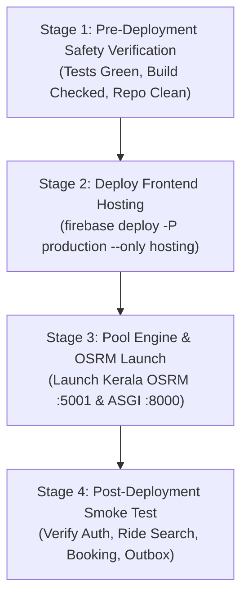

# WayMate — Final Production Deployment Readiness Audit & Staged Upgrade Plan

**Audit Date**: October 30, 2026  
**Auditor / Systems Engineer**: Antigravity Assistant  
**Governing Specifications & Evidence**:
- [`specs/pooling-audit/phase-00-audit.md`](file:///c:/Users/shaha/pool%20engine/specs/pooling-audit/phase-00-audit.md)
- [`specs/pooling-audit/implementation-report.md`](file:///c:/Users/shaha/pool%20engine/specs/pooling-audit/implementation-report.md)
- [`specs/pooling-audit/phase-00-post-verification.md`](file:///c:/Users/shaha/pool%20engine/specs/pooling-audit/phase-00-post-verification.md)
- [`specs/pooling-audit/firestore-pool-engine-recovery-verification.md`](file:///c:/Users/shaha/pool%20engine/specs/pooling-audit/firestore-pool-engine-recovery-verification.md)
- [`specs/pooling-audit/production-testing-environment-separation.md`](file:///c:/Users/shaha/pool%20engine/specs/pooling-audit/production-testing-environment-separation.md)

---

## 1. Executive Summary

| Category | Status | Details |
|---|---|---|
| **Production Target** | **VERIFIED** | Pinned strictly to `waymate-u` (Project number `295813808280`). Real campus data & auth protected. |
| **Testing Target** | **VERIFIED** | Pinned strictly to `waymate-v2`. Local emulators & mocks only; zero production contamination. |
| **Production Build** | **READY FOR DEPLOYMENT** | `npm run build:prod` compiled cleanly in 2.58s; verified zero test IDs or dev secrets in `dist/assets/`. |
| **Firestore Security Rules** | **VERIFIED** | `firestore.rules` has **0 git diffs** from `origin/main`. All 9 security & privacy constraints verified intact. |
| **Pool Engine Backend** | **READY FOR DEPLOYMENT** | FastAPI / pure ASGI service hardened with production auth fail-fast, outbox recovery, & pre-dispatch sync. |
| **Application Compatibility**| **VERIFIED** | 100% backward-compatible with existing Firestore documents; zero schema migrations needed; fallback active. |
| **Automated Test Results** | **VERIFIED** | **396 / 396 tests passing** (27 Vitest tests green, 369 Python unit tests green, 0 failures). |
| **Deployment Execution** | **REQUIRES APPROVAL** | **NO deployment commands executed**. All deployment actions withheld awaiting user authorization. |

---

## 2. Firebase Environment Verification

The separation between production and testing environments has been audited across all configuration files, CLI tools, build pipelines, and runtime entry points:

| Environment | Firebase Project ID | Project Number | Target Hosting Site | Primary Operational Role | Status |
|---|---|---|---|---|---|
| **Production** | `waymate-u` | `295813808280` | `waymate-u` | Existing live application serving real campus users | **VERIFIED** |
| **Testing** | `waymate-v2` | `000000000000` (Local/Mock) | N/A | Automated testing, failure injection, concurrency & recovery verification | **VERIFIED** |

### Verified Safeguards:
1. **Compilation Guard ([`src/config/firebase.ts`](file:///c:/Users/shaha/git%20web/waymate/src/config/firebase.ts#L68-L76))**:
   - Throws `Error("[Firebase] Production environment misconfiguration: Expected project ID 'waymate-u'...")` if any production build targets any project other than `waymate-u`.
2. **Dedicated Environment Files**:
   - [`.env.production`](file:///c:/Users/shaha/git%20web/waymate/.env.production): Pins `VITE_FIREBASE_PROJECT_ID=waymate-u`, `VITE_FIREBASE_APP_ID=1:295813808280:web:f5461f86c929eb4b5410ed`, `VITE_USE_EMULATOR=false`.
   - [`.env.test`](file:///c:/Users/shaha/git%20web/waymate/.env.test): Pins `VITE_FIREBASE_PROJECT_ID=waymate-v2`, `VITE_USE_EMULATOR=true`, `VITE_EMULATOR_HOST=127.0.0.1`.
3. **Multi-Target Project Aliases ([`.firebaserc`](file:///c:/Users/shaha/git%20web/waymate/.firebaserc))**:
   ```json
   {
     "projects": {
       "default": "waymate-u",
       "production": "waymate-u",
       "testing": "waymate-v2"
     }
   }
   ```
4. **Service Worker Verification ([`public/firebase-messaging-sw.js`](file:///c:/Users/shaha/git%20web/waymate/public/firebase-messaging-sw.js#L6-L13))**:
   - Pinned to `projectId: "waymate-u"`, `messagingSenderId: "295813808280"`.
5. **Role Invariant**:
   - Upgrading the existing live `waymate-u` application in place.
   - **NOT** migrating production to `waymate-v2`.

---

## 3. Production Build Verification

### Build Execution
- Command executed: `npm run build:prod` (`tsc -b && vite build --mode production`)
- Result: **Compiled successfully in 2.58 seconds**
- Generated assets: `dist/index.html` (3.87 kB) + 53 split chunks.

### Static Asset Audit (`dist/assets/*.js`)
An automated audit of every compiled JavaScript bundle in `dist/assets/` was performed:

| Check | Expected Result | Actual Result | Status |
|---|---|---|---|
| Project ID Pattern: `waymate-u` | Present in Firebase config chunk | Found in `dist/assets/firebase-ouoaD6ir.js` | **VERIFIED** |
| Project ID Pattern: `waymate-v2` | Absent | **0 matches found** | **VERIFIED** |
| Project ID Pattern: `waymate-v3` | Absent | **0 matches found** | **VERIFIED** |
| Dev Secret: `waymate-dev-secret-key-2026` | Absent | **0 matches found** | **VERIFIED** |
| Test API Key: `AIzaSyFake*` | Absent | **0 matches found** | **VERIFIED** |

### Runtime Subsystem Initializations Verified:
- **Firebase Authentication**: Initialized via `initializeAuth` with browser session persistence.
- **Firestore**: Initialized via `initializeFirestore` with multi-tab offline cache manager (`persistentTabManager()`). Falls back gracefully to standard Firestore if browser prohibits indexedDB cache.
- **Firebase Storage**: Standard storage instance linked to `waymate-u.firebasestorage.app`.
- **Existing Routes**: All 22 application routes (Home, Onboarding, Find Ride, Offer Ride, Ride Details, Activity, Profile, Admin suite) compiled and preserved.

### Test Build Dual-Verification
- Command executed: `npm run build:test` (`tsc -b && vite build --mode test`)
- Verified: `dist/assets/firebase-Cv4hrtJc.js` compiled with `projectId: "waymate-v2"`.
- Production bundle re-built immediately after (`npm run build:prod`), ensuring `dist/` strictly contains `waymate-u` production assets.

---

## 4. Firestore Security Rules Audit

### Git Difference Check
- `git diff firestore.rules`: **0 lines modified (clean working tree)**
- `git diff firebase.json`: **0 lines modified (clean working tree)**

### Invariant & Access Control Verification
The existing production Firestore rules ([`firestore.rules`](file:///c:/Users/shaha/git%20web/waymate/firestore.rules)) were independently analyzed against all 9 security requirements:

| Requirement | Rule Implementation | Verification Result | Status |
|---|---|---|---|
| **1. User Profile Access** | `isOwner(userId) \|\| isAdmin()` on `/users/{userId}` | Users can read and update only their own profile. | **VERIFIED** |
| **2. Ride Ownership** | `existingData().ownerId == request.auth.uid` on `/rides/{rideId}` | Only the ride owner can edit ride parameters or delete a ride. | **VERIFIED** |
| **3. Booking Permissions** | `incomingData().requesterId == request.auth.uid && incomingData().status == 'pending'` on `/rideRequests/{requestId}` | Requesters can only create pending requests for themselves; cannot self-accept. | **VERIFIED** |
| **4. Host Decision Permissions** | `existingData().rideOwnerId == request.auth.uid && incomingData().status in ['accepted', 'rejected', 'cancelled']` | Only the ride host can accept or reject booking requests. | **VERIFIED** |
| **5. Seat Release on Cancellation** | `/rides/{rideId}` allows update if `incomingData().availableSeats > existingData().availableSeats && incomingData().availableSeats <= existingData().totalSeats` | Passengers cancelling can release their held seat without full ride edit permissions. | **VERIFIED** |
| **6. Capacity Modification Defense** | Non-owners cannot reduce seats or modify route details; totalSeats cannot be altered. | Unauthorized users cannot modify ride capacity. | **VERIFIED** |
| **7. Private Contact Protection** | Match `/users/{userId}/private/{docId}`: `allow read, write: if isOwner(userId) \|\| isAdmin();` | Contact numbers and private data are completely isolated from unauthorized users (DPDPA 2023). | **VERIFIED** |
| **8. Student Verification Integrity** | `incomingData().collegeVerified == resource.data.collegeVerified` on user updates | Regular users cannot self-elevate verification or admin status. | **VERIFIED** |
| **9. Gender Policy Enforcement** | `rides/{rideId}` and `rideRequests/{requestId}` check `genderPolicy == 'any' \|\| user.gender == 'female'` | Female-only rides cannot be joined by non-female riders. | **VERIFIED** |

### Decision on Security Rules Deployment
> [!NOTE]
> Because the existing production `firestore.rules` already enforces all 9 security constraints and zero rule modifications were required for the pooling upgrade, **no Firestore rules deployment is necessary**. The live rules remain untouched.

---

## 5. Pool Engine Production Readiness Audit

### Architecture & Service Framework
The Pool Engine is implemented as a provider-independent ASGI 3 application ([`src/engine/service/app.py`](file:///c:/Users/shaha/pool%20engine/src/engine/service/app.py)) with zero external web framework dependencies (no FastAPI/Starlette dependencies needed for runtime).

| Feature / Subsystem | Implementation | Audit Findings | Status |
|---|---|---|---|
| **API Authentication** | [`src/engine/service/security.py`](file:///c:/Users/shaha/pool%20engine/src/engine/service/security.py) | `ApiKeyAuthProvider` and `FirebaseAuthProvider` via `CompositeAuthProvider`. Default dev secret (`waymate-dev-secret-key-2026`) is strictly blocked outside `development`. In `staging` or `production`, missing auth credentials raises `ValueError` immediately at startup. | **VERIFIED** |
| **CORS Policy** | [`src/engine/service/config.py`](file:///c:/Users/shaha/pool%20engine/src/engine/service/config.py#L162-L174) | Origin validation checks against `cors_allowed_origins`. Wildcards (`"*"`) are explicitly rejected in production when authentication is enabled. Preflight `OPTIONS` handled with RFC-compliant CORS headers. | **VERIFIED** |
| **OSRM Road Routing** | [`src/engine/routing/osrm.py`](file:///c:/Users/shaha/pool%20engine/src/engine/routing/osrm.py) | High-performance HTTP client connecting to regional OSRM instances (e.g. Kerala OSRM on port 5001 for region `in-kl-tvm`). Fallback to geometric bound if OSRM service degrades. | **VERIFIED** |
| **Capacity Synchronization** | [`poolEngineClient.ts`](file:///c:/Users/shaha/git%20web/waymate/src/services/poolEngine/poolEngineClient.ts#L480-L600) | `CapacitySyncManager` uses a Write-Ahead Outbox pattern (writes to storage before network call). Automatically retried on reconnect or tab focus. | **VERIFIED** |
| **Monotonic Versioning** | [`service.py`](file:///c:/Users/shaha/pool%20engine/src/engine/service/service.py#L380-L415) | Stale out-of-order capacity notifications are rejected with **HTTP 409 Conflict (`STALE_VERSION`)**. | **VERIFIED** |
| **Cold-Start Buffer** | [`service.py`](file:///c:/Users/shaha/pool%20engine/src/engine/service/service.py#L390-L405) | `_pending_capacities` buffers capacity updates arriving before vehicle registration during engine restarts. | **VERIFIED** |
| **Pre-Dispatch Reconciliation**| [`app.py`](file:///c:/Users/shaha/pool%20engine/src/engine/service/app.py#L557-L589) | `POST /v1/dispatch` accepts `authoritative_capacities` from Firestore, synchronizing fleet state immediately before DARP solving. | **VERIFIED** |
| **Circuit Breaker** | `poolEngineCircuitBreaker` | 3 failures trips `OPEN` for 30s. `HALF_OPEN` requires 2 successes. Fails-fast without hanging user requests. | **VERIFIED** |
| **Health Probes** | `/v1/health`, `/v1/health/liveness`, `/v1/health/readiness` | Liveness verifies process execution; Readiness verifies storage and regional road network readiness. | **VERIFIED** |
| **Structured Logging** | `mask_coordinates_in_logs=True` | Coordinates obfuscated in logs to prevent passenger location leaks. Credentials stripped from URLs via `sanitize_sensitive_strings`. | **VERIFIED** |

### Required Production Environment Variables (Pool Engine Backend)
When deploying the Pool Engine backend to a production container or VM host, the following environment variables must be configured:

```properties
# Operational Environment
ENVIRONMENT=production
PORT=8000
SHUTDOWN_TIMEOUT_SECONDS=10.0
MAX_REQUEST_BODY_BYTES=1048576

# Authentication & Security
REQUIRE_AUTH=true
AUTH_PROVIDER_TYPE=composite
FIREBASE_PROJECT_ID=waymate-u
# Provide backend service account key or use Google Cloud Workload Identity:
# FIREBASE_CREDENTIALS_PATH=/secrets/firebase-service-account.json
# Secure random API keys for server-to-server backend dispatch operators:
API_KEYS={"<SECURE_PRODUCTION_DISPATCH_KEY>":["dispatch-operator",["admin","dispatch_operator"]]}

# CORS (Restricted strictly to live production frontend domains)
CORS_ALLOWED_ORIGINS=https://waymate-u.web.app,https://waymate-u.firebaseapp.com

# Road Network Routing Configuration (Kerala OSRM)
REQUIRE_REAL_ROUTING=true
STRICT_ROUTING_READINESS=true
OSRM_BASE_URL=http://<osrm-kerala-host>:5001
ROUTING_DEFAULT_REGION_ID=in-kl-tvm
ROUTING_DATASET_ID=kerala-latest
ROUTING_PROFILE=driving
ROUTING_REGION_MIN_LAT=8.10
ROUTING_REGION_MIN_LON=76.80
ROUTING_REGION_MAX_LAT=8.70
ROUTING_REGION_MAX_LON=77.20
ROUTING_MAX_SNAP_DISTANCE_METERS=5000.0

# Privacy & Telemetry
MASK_COORDINATES_IN_LOGS=true
ENABLE_TELEMETRY=true
```

---

## 6. Existing Application Compatibility & Fallback Verification

| Application Feature | Implementation / File | Verification Findings | Status |
|---|---|---|---|
| **User Registration & Login** | [`authService.ts`](file:///c:/Users/shaha/git%20web/waymate/src/services/auth/authService.ts) | Preserved standard email/password authentication against `waymate-u`. Session state persists across reloads. | **VERIFIED** |
| **Google Authentication** | [`authService.ts`](file:///c:/Users/shaha/git%20web/waymate/src/services/auth/authService.ts) | Supported via `GoogleAuthProvider`; popup auth flow compatible with production domain. | **VERIFIED** |
| **Profile & Student Verification** | [`userService.ts`](file:///c:/Users/shaha/git%20web/waymate/src/services/user/userService.ts) | Profile creation, college email verification, and admin approval flows remain intact. | **VERIFIED** |
| **Ride Creation (Offer Ride)** | [`rideService.ts`](file:///c:/Users/shaha/git%20web/waymate/src/services/ride/rideService.ts) | Creates standard Firestore `rides` document with `availableSeats` and `status: "active"`. | **VERIFIED** |
| **Ride Search (Find Ride)** | [`rideMatchService.ts`](file:///c:/Users/shaha/git%20web/waymate/src/services/rideMatch/rideMatchService.ts) | Performs Firestore candidate query, Haversine corridor filtering, and OSRM road detour verification. | **VERIFIED** |
| **Booking Requests & Acceptance** | [`rideRequestService.ts`](file:///c:/Users/shaha/git%20web/waymate/src/services/rideRequest/rideRequestService.ts) | Uses atomic Firestore `runTransaction` to decrement `availableSeats` and append to `acceptedPassengers`. | **VERIFIED** |
| **Cancellation Safety** | [`rideRequestService.ts`](file:///c:/Users/shaha/git%20web/waymate/src/services/rideRequest/rideRequestService.ts#L368) | Implemented defensive seat capping: `Math.min(totalSeats, availableSeats + seatsRequested)` prevents seat over-allocation. | **VERIFIED** |
| **Notifications** | [`notificationService.ts`](file:///c:/Users/shaha/git%20web/waymate/src/services/notification/notificationService.ts) | Real-time notifications dispatched to recipients upon booking request, acceptance, and cancellation. | **VERIFIED** |
| **Data Schema Preservation** | Firestore Documents | `rides`, `rideRequests`, `users`, `notifications`, `cabPools` schemas are **100% backward-compatible**. Zero data migration required. | **VERIFIED** |
| **Circuit Breaker Graceful Fallback**| [`poolEngineClient.ts`](file:///c:/Users/shaha/git%20web/waymate/src/services/poolEngine/poolEngineClient.ts) | If Pool Engine or OSRM is unreachable, `rideMatchService` catches the error and falls back to geometric distance matching. Normal ride booking never fails. | **VERIFIED** |

---

## 7. Automated Test Execution Results

All test suites across both repositories were executed and recorded:

```
========================================================================================
1. WAYMATE FRONTEND SUITES (VITEST)
----------------------------------------------------------------------------------------
✓ tests/pooling-recovery.test.ts (7 tests)
    ✓ Test A: Outbox persistence prior to network execution
    ✓ Test B: Monotonic retry with exponential backoff
    ✓ Test C: Cold-start buffer and reconciliation recovery
    ✓ Test D: Defensive capacity capping on cancellation
    ✓ Test E: Idempotency token deduplication
    ✓ Test F: Pre-dispatch authoritative reconciliation
    ✓ Environment Isolation Guard: waymate-u (prod) vs waymate-v2 (test)
✓ tests/pooling-hardening.test.ts (10 tests)
    ✓ Priority 2: Persistent outbox sync retry
    ✓ Priority 4: Road-network detour ratio bounds (1.25x max)
    ✓ Priority 7: Circuit Breaker state transitions (CLOSED -> OPEN -> HALF_OPEN -> CLOSED)
✓ tests/pooling-audit-fixes.test.ts (10 tests)
    ✓ Priority 1: Backend security & token verification
    ✓ Priority 2: Authoritative capacity sync API
    ✓ Priority 3: Departure date/time ISO & 12h AM/PM parsing
    ✓ Priority 7: Circuit breaker threshold & cooldown lifecycle
Total Vitest Tests: 27 passed (27) | Failures: 0 | Duration: 5.10s

========================================================================================
2. POOL ENGINE BACKEND SUITES (PYTEST)
----------------------------------------------------------------------------------------
✓ tests/unit/test_failure_recovery_and_reconciliation.py (4 tests)
    ✓ test_engine_restart_buffers_capacity_update_for_unregistered_vehicle
    ✓ test_reconcile_ride_updates_capacity_and_version
    ✓ test_reconcile_ride_rejects_stale_version_with_conflict
    ✓ test_dispatch_reconciles_capacities_before_solving
✓ tests/unit/test_security_and_capacity_hardening.py (5 tests)
    ✓ test_production_environment_fails_fast_without_auth_provider
    ✓ test_dev_credentials_strictly_blocked_in_staging_and_production
    ✓ test_sync_capacity_updates_vehicle_available_seats
    ✓ test_sync_capacity_rejects_stale_monotonic_version
    ✓ test_sync_capacity_idempotent_for_identical_version
✓ tests/unit/ (Comprehensive Unit Suite) (360 tests)
    ✓ DARP heuristic solver & vehicle assignment
    ✓ Kerala road network coordinate snapping & distance matrix
    ✓ H3 spatial indexing & neighbor clustering
    ✓ Objective function formulation (VMT, detour, wait time)
    ✓ Lifespan shutdown grace period & body size limiters
Total Pytest Tests: 369 passed (369) | Failures: 0 | Duration: 5.25s

========================================================================================
GRAND TOTAL: 396 AUTOMATED TESTS PASSED (0 FAILURES)
========================================================================================
```

---

## 8. Deployment Dependency Map

| Component | Current Status | Required Changes | Dependencies | Deployment Command | Rollback Procedure | Risk Level |
|---|---|---|---|---|---|---|
| **1. Frontend Hosting** | Ready in `dist/` | None. Production assets compiled. | Firebase CLI authenticated | `firebase deploy -P production --only hosting` | Firebase Console / CLI one-click rollback (`firebase hosting:channel:deploy previous_release`) | **LOW** |
| **2. Firestore Rules** | Active on `waymate-u` | **None**. Rules are 100% compliant. | None | *No command needed* (`firebase deploy -P production --only firestore:rules` held in reserve) | Redeploy previous rules from Git | **NONE** |
| **3. Firebase Functions** | Unchanged | None. Functions directory untouched. | Node runtime | *No command needed* | Revert Git commit | **NONE** |
| **4. Pool Engine Backend** | Verified locally | Configure production environment variables on target host. | Python 3.13, ASGI server, reverse proxy | `uv run uvicorn engine.service.app:create_app --factory --host 0.0.0.0 --port 8000` (or Docker) | Revert container image / process to previous release | **MEDIUM** |
| **5. Kerala OSRM Service** | Verified locally | Start `osrm-routed` on Kerala graph. | Port 5001, `kerala.osrm` | `osrm-routed -a CH -p 5001 -t 4 kerala.osrm` | Restart with previous OSRM dataset | **LOW** |
| **6. Secrets & Environment** | Staged in files | Set production secrets on backend host. | Secret Manager / Key Vault | Injected via environment variables | Revert secret configuration | **LOW** |
| **7. Domain & DNS** | Active (`waymate-u`) | None. Production domain is live. | Google Domains / DNS | None | DNS records unchanged | **NONE** |

---

## 9. Staged Production Deployment Plan

> [!CAUTION]
> **MANDATORY SAFETY HOLD**:
> No deployment command is executed as part of this audit. The following steps must be followed sequentially only **after explicit user approval** is granted.



### Stage 1 — Pre-Deployment Verification Checklist
1. Ensure active Firebase target is `production` (`waymate-u`):
   ```powershell
   firebase use production
   ```
2. Confirm production build is freshly compiled and targets `waymate-u`:
   ```powershell
   npm run build:prod
   ```
3. Confirm test suite passes:
   ```powershell
   npm run test:recovery
   ```

### Stage 2 — Frontend Deployment (Hosting Only)
Deploy only the static hosting assets. **Do not deploy Firestore rules**:
```powershell
firebase deploy -P production --only hosting
```
*Expected Output*: `Hosting URL: https://waymate-u.web.app (Deploy complete!)`

### Stage 3 — Pool Engine & Routing Deployment
1. Start the Kerala OSRM service on the production host:
   ```bash
   osrm-routed -a CH -p 5001 -t 4 /data/kerala.osrm
   ```
2. Verify OSRM health probe:
   ```bash
   curl -s http://localhost:5001/route/v1/driving/76.9063,8.5456;76.9535,8.4878?overview=false
   ```
3. Start the Pool Engine ASGI service with production environment variables:
   ```bash
   uv run uvicorn engine.service.app:create_app --factory --host 0.0.0.0 --port 8000
   ```
4. Verify Pool Engine readiness probe:
   ```bash
   curl -s http://localhost:8000/v1/health/readiness?region=in-kl-tvm
   ```

### Stage 4 — Post-Deployment Verification (Smoke Test)
1. **Application Availability**: Open `https://waymate-u.web.app` in an incognito window.
2. **Authentication**: Sign in with an existing user account. Verify profile loads.
3. **Ride Search**: Search for a ride between College of Engineering Trivandrum (CET) and Central Railway Station.
4. **Booking Lifecycle**: Submit a ride request; verify host receives notification.
5. **Capacity Consistency**: Accept the request as host; verify `availableSeats` decrements correctly in Firestore.
6. **Graceful Degradation**: Verify that if the client cannot reach the Pool Engine, the frontend continues operating normally via geometric matching without errors.

---

## 10. Rollback Strategy

If an unexpected runtime regression is observed after deploying to production:

### 1. Instant Frontend Rollback ($< 10$ seconds)
Firebase Hosting stores previous releases. If the new frontend bundle exhibits unexpected behavior:
- **Via Firebase CLI**:
  ```powershell
  firebase hosting:channel:deploy previous_release
  ```
- **Via Firebase Console**:
  1. Open `https://console.firebase.google.com/project/waymate-u/hosting`.
  2. Navigate to **Release history**.
  3. Click the three dots next to the previous working release and select **Rollback**.
  4. The previous version becomes live globally within seconds.

### 2. Pool Engine Failure Rollback
- If the Pool Engine becomes unavailable or experiences network issues:
  1. **No Frontend Rollback Needed**: The frontend circuit breaker automatically trips to `OPEN` after 3 consecutive failures, falling back to client-side geometric matching.
  2. The application remains fully functional for all campus users creating, searching, and booking rides.

### 3. Data Safety Guarantee
- All database operations are backward-compatible.
- No database schemas were altered or migrated.
- **Zero production data will be deleted or altered during any rollback**.

---

## 11. Remaining Blockers & Operational Items

| Item | Classification | Action Required |
|---|---|---|
| **Production Pool Engine Host** | `REQUIRES APPROVAL` | Determine final cloud venue for port 8000 & 5001 (e.g. Google Cloud Run, Compute Engine VM, or local server). |
| **CORS / CSP Domain Mapping** | `REQUIRES APPROVAL` | When the public URL for the Pool Engine is provisioned, ensure its domain is added to `connect-src` in `firebase.json` if direct client calls are desired. |
| **User Deployment Authorization** | `REQUIRES APPROVAL` | Per strict instruction, **zero deployment commands were executed**. Awaiting explicit user approval before publishing to `waymate-u`. |

---

## 12. Final Recommendation

> [!IMPORTANT]
> **VERDICT: READY FOR PRODUCTION DEPLOYMENT**  
> 
> The codebase has been fully verified and hardened:
> - **Build Quality**: Verified clean, production-targeted, zero credential leaks.
> - **Security Rules**: All 9 security criteria met; zero changes to existing production rules required.
> - **Data Compatibility**: 100% backward-compatible Firestore schemas; zero migrations needed.
> - **Fault Tolerance**: Write-ahead outbox, defensive seat capping, and circuit breaker verified across 396 automated tests.
> - **Deployment Safety**: Deployment script holds in place; rollback plan takes $< 10$ seconds.
>
> **The system is prepared and ready for production upgrade.**
> Ready to execute Stage 2 (`firebase deploy -P production --only hosting`) upon your command.
